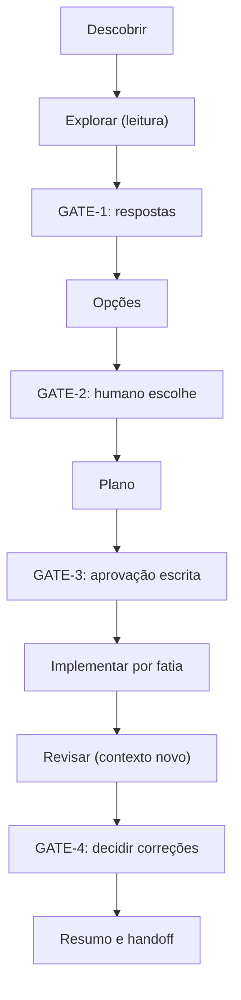

# Modos, gates e critérios de saída

Sumário: 1. Máquina de estados · 2. Modelos de pergunta de gate · 3. Critérios de saída por fase · 4. Plano de uma linha · 5. Protocolo de retrabalho · 6. Notas de contexto e continuidade · 7. Gotchas · 8. Modo sem interação

Validado em 2026-10-10. Fontes: V-09 (feature-dev; todos os direitos reservados, só destilação), V-03 (explorar, planejar, implementar; revisor em contexto novo), V-20 (pesquisar, planejar, anotar), V-17 e V-18 (plano e protocolo de retrabalho), V-08 (escala de subagentes), V-02 (compaction e notas fora da janela). Redação própria.

## 1. Máquina de estados do modo `feature`



Regra: nenhuma transição sai de um gate sem resposta do usuário no chat. Em tarefa pequena, use só opções + GATE-2 (V-09).

## 2. Modelos de pergunta de gate

Formato fixo: contexto em uma linha, pergunta exata, recomendação, opções, consequência de não responder.

**GATE-1 (esclarecer requisitos)**
```text
GATE-1. Antes de desenhar preciso de respostas para 3 pontos:
1. <pergunta mais bloqueante>  (recomendação: <X>, porque <motivo>)
2. ...
Sem respostas, não avanço. Se preferir, diga "assuma as recomendações" e eu as registro como Suposição.
```

**GATE-2 (escolher arquitetura)**
```text
GATE-2. Opções:
A) <opção>: prós ..., contras ...
B) <opção>: ...
C) Não mudar nada: ...
Recomendação: B (confiança média), porque <motivo>. Qual escolhe? Dono da decisão: <nome ou "a definir">.
```

**GATE-3 (aprovar o plano)**
```text
GATE-3. O plano está em docs/plans/<slug>/plan.md (<n> fases, <m> requisitos, rollback descrito).
Decisões humanas pendentes: <lista>.
Aprova a implementação deste plano? (responda "aprovado" ou diga o que ajustar)
```

**GATE-4 (correções após revisão)**
```text
GATE-4. O revisor encontrou <n> lacunas: <ARQ-01 (alto): ...>, <ARQ-02 (médio): ...>.
Recomendo corrigir agora: ARQ-01. Adiar: ARQ-02 (registrar em pendências). O que corrijo?
```

## 3. Critérios de saída por fase

| Fase | Pronto quando | Evidência |
| --- | --- | --- |
| Descobrir/explorar | Fluxos críticos descritos; ADRs lidos | `research.md` com `arquivo:linha` |
| GATE-1 | Perguntas respondidas ou premissas aceitas como Suposição | Resposta do usuário no chat |
| Opções | 1 a 3 opções com prós/contras, "não mudar nada", recomendação | Texto no chat |
| Plano | REQ em EARS; fases com critério verificável; rollback; decisões humanas | `plan.md` |
| GATE-3 | Aprovação escrita neste chat | Mensagem do usuário |
| Implementar | Cada fase: verificação executada, checkbox com saída colada | Saída de teste/lint/build no chat |
| Revisar | Revisor em contexto novo reportou ou disse "sem lacunas" | Relatório do revisor |
| GATE-4 | Usuário decidiu o destino de cada achado | Mensagem do usuário |
| Resumo | Entregue/Verificado/Pendências/Riscos/Próximo passo | `handoff.md` |

## 4. Plano de uma linha (mudança trivial)

Se a diff cabe em uma frase, não crie arquivos:

```text
Plano (1 linha): trocar o timeout do cliente de pagamento de 30 s para 5 s em src/payments/client.ts:42.
Verificação: rodar `<comando de teste do módulo>` e colar a saída. Rollback: reverter o commit.
Prossigo? (sim/não)
```

Mesmo no plano de uma linha, confirme com o usuário se a mudança afeta contrato, dados ou segurança; nesses casos use o fluxo completo.

## 5. Protocolo de retrabalho (V-18, C-16)

1. Falhou a verificação de uma fase: reanalise a causa (releia o código afetado e a saída completa do erro).
2. Formule uma hipótese e teste-a; registre a hipótese no plano.
3. Depois de 3 tentativas falhas na mesma fase: pare. Reporte o que foi tentado, a saída dos testes, o que se sabe, o que não se sabe e as opções (replanejar, reduzir escopo, pedir ajuda).
4. Não "enfraqueça" o teste para passar nem comente o teste; isso esconde o problema (AP-14).

## 6. Notas de contexto e continuidade

- Sessão longa: antes de a janela encher, escreva um handoff (decisões tomadas, alternativas descartadas com motivo, perguntas em aberto, estado da fase) para retomar em sessão nova (V-02). O limiar de 40% de contexto citado em comunidade é disputado: meça (P-12).
- Subagentes devolvem resumo curto, não a transcrição; briefing de 7 campos e regra de escala em `${CLAUDE_PLUGIN_ROOT}/skills/playbook/assets/templates/subagent-briefing.md`.
- Sem `git` na skill: a reversão de direção errada é feita pelo usuário (ou por comando que ele aprove).

## 7. Gotchas

- Pular o GATE-3 "porque o plano é óbvio" é o erro de maior custo; se for óbvio, é caso de plano de uma linha.
- Gate sem recomendação transfere o trabalho ao usuário; sempre recomende, com confiança e motivo.
- Revisor que "sempre acha algo": restrinja a lacunas de correção e requisitos (V-03).
- Fases grandes demais escondem falhas; prefira fatias verticais que terminam com algo verificável.
- Checkbox marcado sem saída colada é afirmação de execução que pode não ter ocorrido: evite.

## 8. Modo sem interação (gates como pendências)

Origem: uma demonstração em lote do plugin, em que não havia quem respondesse aos gates; o executor substituiu os gates por uma tabela de decisões e funcionou. Aqui isso é regra.

Cada gate que esperaria resposta vira uma linha (exemplo ilustrativo; GATE-4 não existe porque nada foi implementado):

```text
Modo sem interação: gates convertidos em pendências; nada implementado.

## Decisões pendentes do humano
| ID | Gate de origem | Pergunta exata | Recomendação (confiança) | Dono | Bloqueia |
| --- | --- | --- | --- | --- | --- |
| D-1 | GATE-1 | O app precisa funcionar sem rede por mais de 24 h? | Sim; manter armazenamento local (média) | Dono do produto: <nome> | Fase 2 (retenção) |
| D-2 | GATE-2 | Módulo único ou separar `data`? | Módulo único (alta; 38 arquivos) | Tech lead: <nome> | Fase 3 |
| D-3 | GATE-3 | Aprova a implementação deste plano? | Aprovar após D-1 e D-2 | Dono do plano: <nome> | Toda implementação |
```

Regras: (1) dono é uma pessoa ou papel, nunca "o agente"; sem dono conhecido, "a definir". (2) A recomendação entra no plano como Suposição, e cada fase que depende dela cita o ID da pendência. (3) `plan.md` com `status: rascunho` até alguém aprovar no chat; o modo sem interação nunca altera o status. (4) Perguntas de entrevista (ADR, system-design) usam o mesmo padrão com `[NEEDS CLARIFICATION]` no texto. (5) Quando o humano voltar, ele responde às pendências, o plano é atualizado com `anotar`, e o GATE-3 acontece de verdade.
