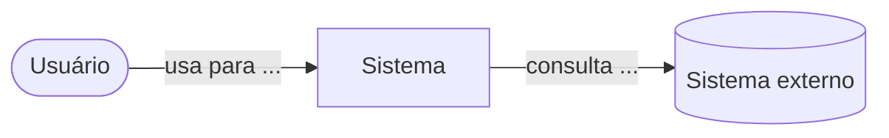
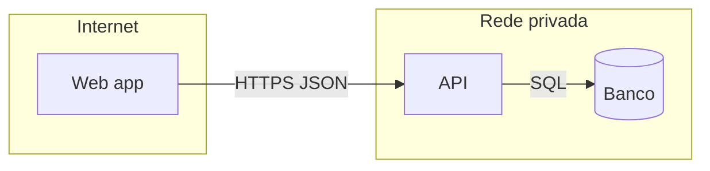

<!-- C4 níveis 1 e 2 com Mermaid. Um nível por diagrama, 5 a 15 nós. Contexto: sem tecnologia. Contêiner: tecnologia e protocolos de alto nível. -->
# [Sistema]: contexto e contêineres

Data: [AAAA-MM-DD] · Revisão do código: [hash] · Autor: [nome]

## Nível 1: contexto do sistema
Visão curta: [uma frase que um não técnico entende]

Personas e sistemas externos:
| Ator ou sistema | Humano ou programático | Interage para |
| --- | --- | --- |

Legenda: ( ) pessoa · [ ] sistema · [( )] sistema externo.

## Nível 2: contêineres
| Contêiner | Responsabilidade | Tecnologia | Interfaces (API, evento) | Dono dos dados |
| --- | --- | --- | --- | --- |

Legenda: [ ] processo · [( )] armazenamento · [[ ]] fila. Fronteiras de confiança: subgrafos.

## Ligações inferidas ou só de runtime
[Rotuladas Inferido, com a evidência que falta.]

## Parse validado?
[sim, por quem e como | não validado]
