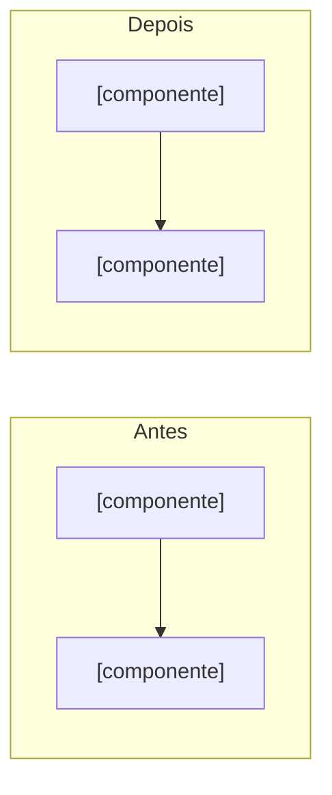

<!--
Arquitetura-alvo do sistema inteiro (modo "sistema" do agente architecture-blueprint). Use quando o pedido for
"como deve ficar a arquitetura toda, com plano de migração", não para uma feature isolada (essa usa as 9 seções
do blueprint). Origem: avaliação de um uso real em app Android Kotlin (2026-10-10), que precisou acrescentar estas
seções por conta própria. Preencha só o que o sistema pede; seção sem conteúdo diz "Não aplicável" com motivo.
Evidência: arquivo:linha para código; git:<hash>:<caminho>, http:<url>@<data> e contagem:<ferramenta e padrão> para o resto.
Rótulos: Verificado, Inferido, Suposição, Não verificável, Proposta (desenho novo, ainda não existe no código).
Dados pessoais: cite a chave e a linha, nunca o valor.
-->
# Arquitetura-alvo: [sistema]

Status: rascunho · Data: [AAAA-MM-DD] · Dono da decisão: [nome humano ou "pendente"] · Confiança: [alta | média | baixa]
Base: [mapa atual, revisão e contraprova usados; caminhos] · Tamanho analisado: [arquivos, linhas, pacotes; contagem rotulada]

## 1. Resumo e decisão

[Até 5 linhas: a recomendação (uma só), o que se ganha, o que se paga. Proporcionalidade: diga o que fica de fora de propósito (sem backend, sem DI de framework, sem multimódulo) e o gatilho que reabriria.]

## 2. Antes × depois

| Aspecto | Antes (Verificado, `arquivo:linha`) | Depois (Proposta) |
| --- | --- | --- |
| Composição das dependências | | |
| Fronteiras entre pacotes ou módulos | | |
| Fluxo crítico (ator → ... → resposta) | | |
| Estado e ciclo de vida | | |
| Dados no dispositivo ou no servidor (donos, retenção) | | |
| Testes que rodam no CI | | |

Diagrama lado a lado (Mermaid, um nível, 5 a 15 nós por lado; dois diagramas, não um com 30 nós):

## 3. Tabela por camada

| Camada | Hoje | Proposto | Por quê | Achado que resolve (ARQ-nn) |
| --- | --- | --- | --- | --- |
| [ex.: apresentação] | | | | |
| [ex.: aplicação] | | | | |
| [ex.: domínio] | | | | |
| [ex.: dados e I/O] | | | | |

Toda linha cita um achado confirmado ou diz "sem achado: preferência" (e então é candidata a sair). Achado refutado na contraprova não entra.

## 4. Alternativas descartadas

| Alternativa | Por que não agora | Volta a valer quando (mensurável) |
| --- | --- | --- |
| Não mudar nada | | |
| [B] | | |

## 5. Migração em fatias

Cada fatia é vertical, reversível e termina com algo verificável. Ordem por risco decrescente de erro e custo crescente de reverter.

| Fatia | Mudança | Pronto quando (comando ou observação) | Testes | Risco | Rollback (e o que não volta) |
| --- | --- | --- | --- | --- | --- |
| F1 | | | | | |
| F2 | | | | | |

Regra: nenhuma fatia depende de uma decisão humana pendente (seção 8). Se depender, ela fica depois do gate e diz qual.

## 6. Fitness functions

Cada regra de fronteira tem um verificador que quebra o build. Em legado com violações existentes use o padrão catraca (lista de violações conhecidas que só encolhe; ver `skills/decomposition/references/fronteiras-verificaveis.md`, seção 3.1).

| Regra | Verificador (comando ou teste) | Estado inicial | Teto da catraca | Executado? |
| --- | --- | --- | --- | --- |
| [ex.: `model` não importa `util`] | | [N violações conhecidas, `contagem:<ferramenta e padrão>`] | [N, só desce] | não executado |

Busque dependências também por nome qualificado fora de linhas `import`, para não perder ciclos.

## 7. Riscos

| ID | Risco (erro, estado, teste, desempenho, segurança, dispositivo) | Mitigação | Sinal precoce |
| --- | --- | --- | --- |
| R-1 | | | |

## 8. Decisões que dependem do humano

| ID | Pergunta exata | Recomendação (confiança) | Dono | Bloqueia |
| --- | --- | --- | --- | --- |
| D-1 | | | | |

## 9. Suposições, o que falta verificar e conteúdo suspeito

[Lista com rótulo. Nada foi compilado nem executado, salvo o que a seção 6 marcar como executado com a saída colada.]
