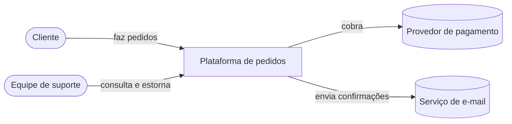
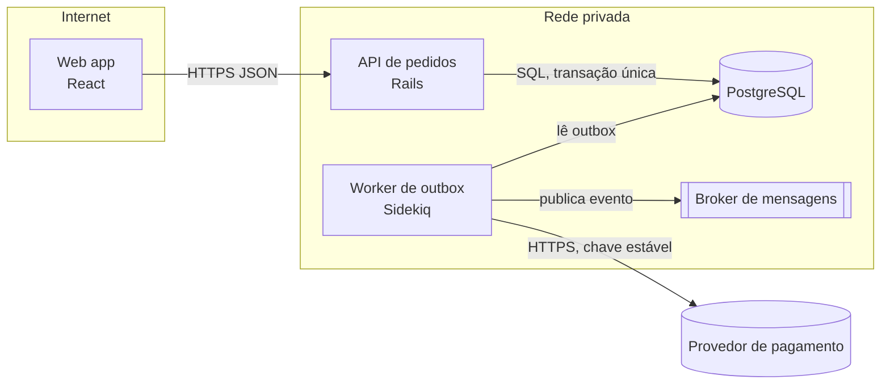
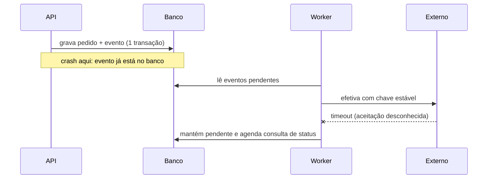
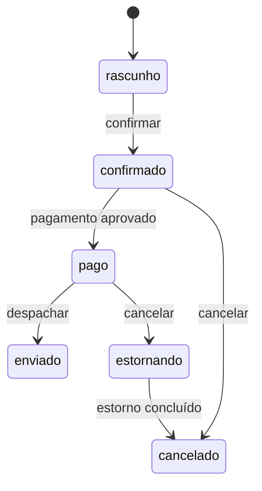

# C4 e diagramas com Mermaid

Validado em 2026-10-10 · Modelo-alvo: Claude 4.x/5.x · Rótulos: Verificado, Inferido, Suposição, Não verificável.
Fontes: modelo C4 (c4model.com, V-21), agentes C4 da wshobson/agents (MIT, V-22), regras de Mermaid do gstack `diagram` (MIT, V-23), exemplo "Diagrams first" da doc de output styles (V-06). Redação própria. A renderização por bundle local, `bun` e binários do gstack fica de fora: executaria código de terceiros.

## Sumário

1. Regras de ouro
2. Níveis C4 e o que mostrar em cada um
3. Mermaid: escolha do tipo de diagrama
4. Exemplos prontos (contexto, contêiner, sequência, estado)
5. Erros comuns de sintaxe
6. Validação de parse
7. Quando dividir um diagrama
8. Legenda, título, data
9. Onde guardar
10. Gotchas

## 1. Regras de ouro (V-23)

1. Mermaid é a fonte; o diagrama vive em arquivo de texto versionado (`docs/architecture/*.mmd` ou bloco em Markdown).
2. Um nível de abstração por diagrama.
3. De 5 a 15 nós. Passou disso, divida e diga por quê.
4. `flowchart LR` para pipelines e fluxos, `flowchart TD` para hierarquias, `sequenceDiagram` para chamadas ao longo do tempo.
5. Rótulo curto no nó, detalhe na aresta.
6. Se o Mermaid não parseia, a entrega fica bloqueada até corrigir. Sem parse válido, sem entrega (snippet S-15).
7. O diagrama é hipótese até ser reconciliado com o código; ligações inferidas ou só de runtime levam marca (linha pontilhada e nota "Inferido").

## 2. Níveis C4 (V-21; síntese reconferida com os agentes de V-22)

A página inicial do C4 só lista os níveis; as descrições abaixo são síntese minha (Inferido, corroborada por V-22).

| Nível | Mostra | Não mostra | Público |
| --- | --- | --- | --- |
| 1. Contexto do sistema | O sistema como uma caixa, usuários (humanos e programáticos) e sistemas externos | Tecnologia, protocolo, componentes | Qualquer pessoa, inclusive não técnica |
| 2. Contêiner | Aplicações e armazenamentos implantáveis, com tecnologia e protocolos de alto nível | Classes e funções | Desenvolvedores, operação |
| 3. Componente | Os componentes de um único contêiner, só os que importam para a mudança | Vários contêineres no mesmo diagrama | Desenvolvedores do contêiner |
| 4. Código | Classes e módulos, sob demanda (muitas vezes gerado) | Arquitetura geral | Quem mexe no código |
| Dinâmico | Um caso de uso com ordem das chamadas | Tudo o mais | Revisores de fluxo |
| Implantação | Infraestrutura onde os contêineres rodam | Lógica de aplicação | Operação |

Regras: tecnologia só entra no nível de contêiner (e abaixo); componente nunca aparece em diagrama de contexto; cada diagrama tem título, legenda e data. Os arquivos de agente `c4-component` e `c4-code` da wshobson não foram lidos: não afirme que seguem o mesmo template.

## 3. Escolha do tipo de diagrama Mermaid

| Pergunta | Tipo | Observação |
| --- | --- | --- |
| Quem fala com quem (estrutura)? | `flowchart LR` ou `TD` | Subgrafos para fronteiras de confiança |
| O que acontece, em que ordem? | `sequenceDiagram` | Ideal para falha parcial, retry, saga |
| Como um objeto muda de estado? | `stateDiagram-v2` | Para ciclo de vida de pedido, saga |
| Estrutura C4 formal | `C4Context`, `C4Container` | Sintaxe C4 do Mermaid é recurso experimental; confira na versão do seu renderizador (Inferido, conhecimento geral) |
| Modelo de dados | `erDiagram` | Detalhe de esquema pertence a `/database-data-modeling:playbook` |

Tipos como estado, classe e gantt renderizam normalmente; o conversor Excalidraw do gstack os exporta como imagem única, o que não importa aqui porque este plugin não usa esse conversor.

## 4. Exemplos prontos

**Nível 1: contexto** (sem tecnologia):



**Nível 2: contêiner** (tecnologia e protocolo na aresta ou no rótulo):



**Fluxo (sequência) com falha parcial:**



**Estados de pedido:**



## 5. Erros comuns de sintaxe (conhecimento geral do Mermaid; Inferido, confirme na versão)

- Parênteses, colchetes ou aspas dentro do texto do nó quebram o parse: coloque o rótulo entre aspas, `A["Serviço (principal)"]`.
- A palavra `end` em minúsculas dentro de rótulo de flowchart pode encerrar um subgrafo: use `End` ou aspas.
- IDs de nó sem espaços; rótulos com espaços entre colchetes.
- Aresta com texto: `A -->|texto| B`.
- `sequenceDiagram`: `->>` chamada, `-->>` resposta, `--x` mensagem perdida; `participant X as Nome`.
- Quebra de linha em rótulo: `<br/>`.
- Diretiva de direção só no topo (`flowchart LR`).

## 6. Validação de parse (Não verificado nesta fábrica)

O critério de entrega é "o Mermaid parseia". O plugin não executa nada. Opções para o usuário, a seu critério (conferir o nome do pacote e a versão antes de instalar; `npx` baixa e executa código de terceiros, ver `ferramentas-e-mcp.md`):

- Colar o código em um editor ao vivo do Mermaid.
- Usar o renderizador do próprio GitHub ou da documentação do projeto, que mostra erro de sintaxe.
- Usar o CLI do Mermaid em ambiente controlado (nome do pacote e uso: conhecimento geral, Não verificado aqui).

Quando não houver como validar, entregue o diagrama com a nota "parse não validado" e peça confirmação; não afirme que renderizou.

## 7. Quando dividir

Divida quando: passar de 15 nós; misturar níveis (contexto e contêiner no mesmo quadro); houver duas histórias diferentes (fluxo feliz e compensação); linhas se cruzarem em mais de 3 pontos. Em vez de um mega-diagrama, crie um diagrama de visão geral (5 a 8 caixas) e um por fronteira. Diga no texto por que dividiu.

## 8. Legenda, título, data

Cada diagrama: título (nível e escopo), legenda das formas (pessoa, sistema, armazenamento, fila) e data com a revisão do código a que corresponde. Exemplo de cabeçalho no arquivo:

```text
%% Título: Contêineres da plataforma de pedidos (C4 nível 2)
%% Data: 2026-10-10 · Revisão: <hash curto> · Autor: <nome>
%% Legenda: [ ] processo · [( )] banco · [[ ]] fila · ( ) pessoa
```

## 9. Onde guardar

`docs/architecture/c4-contexto.md`, `c4-containers.md`, `fluxos/<nome>.md`, com índice no README de `docs/architecture/`. Atualize o diagrama no mesmo PR que muda a fronteira. Template: `assets/templates/c4-context-container.md`.

## 10. Gotchas

- Composer e Structurizr com MCP foram rebaixados a classe C (V-23, VALIDATED): a documentação do fornecedor não afirma o que se atribuía a ela. Não ative MCP de terceiros para diagramas.
- O gstack `diagram` exige um bundle local, `bun` e um script de renderização; ignore esse caminho.
- Um agente pode inventar ligações plausíveis. Todo traço no diagrama precisa de `arquivo:linha` ou de rótulo Inferido.
- Diagrama gerado de código atual descreve o estado de agora; o estado alvo vai em outro diagrama, com a data e o ADR que o motivou.
- A sintaxe `C4Context` do Mermaid tem limitações de layout; para contexto e contêiner, `flowchart` com subgrafos costuma ser mais legível (Inferido).
