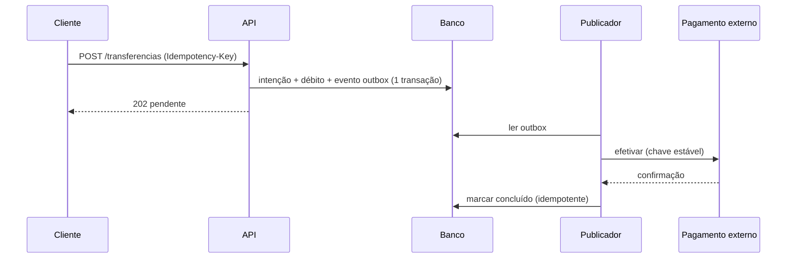

# Padrões e antipadrões de arquitetura

Validado em 2026-10-10 · Modelo-alvo: Claude 4.x/5.x · Rótulos: Verificado, Inferido, Suposição, Não verificável.
Cada padrão traz condição de uso e de NÃO uso. Fontes: V-24 a V-38 (Microsoft Azure Architecture Center, Fowler, Cockburn), V-41, V-43, brain-of-agent (MIT, Francisco Edson). Texto em redação própria; licenças em `fontes.md`.

## Sumário

1. Tabela mestra: padrão, quando usar, quando NÃO, custo
2. Estrutura interna: camadas, hexagonal, monólito modular
3. Evolução: strangler, expand/contract
4. Consistência e resiliência (resumo; checklists em `resiliencia-e-consistencia.md`)
5. Leitura, cache e eventos
6. Antipadrões: sintoma, por que dói, substituto, detecção
7. Exemplo antes/depois (débito e pagamento)
8. Como escolher: três perguntas
9. Gotchas

## 1. Tabela mestra

| Padrão | Use quando | NÃO use quando | Custo principal | Fonte |
| --- | --- | --- | --- | --- |
| Camadas com imports só para baixo | Time precisa de regra simples e verificável (Router, Service, Repository) | A lógica atravessa camadas e cada uma só repassa argumentos | Camadas anêmicas | V-24, V-25 |
| Hexagonal (portas e adaptadores) | Núcleo precisa rodar em teste sem banco nem rede; várias entradas (HTTP, fila, CLI, teste) | Script descartável; domínio trivial | Indireção de portas e adaptadores | V-25 |
| Monólito modular | Equipe pequena; fronteiras ainda incertas; deploy único aceitável | Times com ciclos de entrega incompatíveis bloqueados no mesmo deploy; escala radicalmente diferente por módulo | Disciplina para manter fronteiras verificadas | V-27, V-28 |
| Serviços separados | Motivo nomeado: escala diferente, isolamento de falha, times bloqueados no deploy | "Para escalar" sem métrica; time pequeno sem observabilidade | Rede, observabilidade, consistência, operação | V-27 |
| Strangler Fig | Migrar legado em fatias com roteamento reversível | Sistema pequeno que cabe reescrever com segurança; sem seam | Arquitetura transitória duplicada | V-29 |
| Retry | Falha transitória e operação idempotente | Operação não idempotente; falha permanente; várias camadas já repetem | Amplificação de carga (N-01) | V-31, N-01 |
| Circuit breaker | Dependência remota instável chamada de forma síncrona | Estado local em memória; fila com DLQ já isola; plataforma (mesh, health checks) já recupera | Parâmetros a calibrar; fallback a manter | V-30 |
| Bulkhead | Dependência lenta pode esgotar recurso compartilhado (pool, threads) | Uso menos eficiente de recursos é inaceitável; complexidade não se paga | Capacidade ociosa por partição | V-32 |
| Idempotent consumer | Mensagens at-least-once com efeito não idempotente | Operação naturalmente idempotente (upsert por chave) | Tabela de dedupe, retenção, métrica | V-33 |
| Transactional outbox | Gravar estado e publicar evento (dual write) | Não há broker; evento tolerável de perder | Publicador assíncrono, ordem, limpeza | V-34 |
| Saga | Processo de negócio atravessa vários serviços com transações locais | Transações fortemente acopladas; dependências cíclicas; compensação impossível | Compensações, anomalias de isolamento, monitoramento | V-35 |
| CQRS | Leitura e escrita com escala ou regras muito diferentes; UI orientada a tarefas | Domínio simples ou CRUD suficiente | Consistência eventual, sincronização, dado obsoleto | V-36 |
| Event sourcing | Auditoria e reconstrução histórica valem o custo (ledger, não perfil) | Maioria dos sistemas; times sem estratégia de versionamento de eventos | Evolução de esquema, rehidratação, direito ao esquecimento | V-37 |
| Cache-aside | Leitura é o gargalo comprovado por número; dado tolera obsolescência | Conjunto estático; taxa de acerto baixa; dado sensível em cache compartilhado | Obsolescência, stampede, invalidação | V-38 |
| Parallel change (expand/contract) | Mudar contrato de API ou esquema com consumidores vivos | Todos os consumidores mudam atomicamente | Período de convivência | N-04 |

Regra de leitura da tabela: o gatilho de uso tem de ser observável (métrica, restrição, incidente). "Pode ser útil no futuro" não é gatilho.

## 2. Estrutura interna

**Camadas.** Tabela "camada, pode importar, não pode importar" por projeto e verificador em CI (V-24). Exemplo de quatro camadas: Router, Service, Repository, ORM/HTTP, com imports só para baixo e handler curto. Os limites de linhas do exemplo de origem (verde até 399, amarelo 400 a 599, vermelho a partir de 600) são opinião do autor: Suposição configurável. Dependências do serviço entram por interface (em Python, `Protocol`); um cliente HTTP por provedor externo funciona como bulkhead (V-24).

**Hexagonal.** Quatro perguntas de revisão (V-25): o núcleo roda em teste sem banco e sem rede? Cada tecnologia externa está atrás de uma porta com um adaptador? Algum import do núcleo aponta para fora? As portas de entrada e saída são simétricas? O mock é só um adaptador em memória. A fonte (Cockburn, 2005) critica o diagrama em camadas porque a lógica atravessa as linhas.

**Monólito modular.** Módulos por capacidade de negócio ou bounded context; internos encapsulados; fachadas, APIs ou eventos como contrato; acesso direto à tabela alheia proibido; teste de dependência quebra o build; ao menos um caso de violação documentado (V-28). Detalhes em `fronteiras-e-decomposicao.md`.

## 3. Evolução

- **Strangler** em 7 passos (V-29): resultado mensurável por etapa; seams candidatos com risco; primeira fatia pequena e de baixo risco; roteamento com volta possível (fachada ou proxy: Inferido); código de convivência com data de remoção; critério de desligamento do legado; plano de dados da fatia (lacuna da fonte, que não trata de migração de dados).
- **Expand/contract** (N-04): adicionar a forma nova ao lado da antiga, migrar consumidores, remover a antiga. Para esquema de banco a aplicação do mesmo raciocínio é Inferido (a fonte trata de interfaces).

## 4. Consistência e resiliência (resumo)

Idempotência antes de repetir; uma só camada de retry; estado e evento na mesma transação; consumidor deduplica mesmo quando o broker deduplica; saga com pivô e passos pós-pivô idempotentes; "exactly-once" fim a fim não é promessa. Checklists numerados em `resiliencia-e-consistencia.md`.

## 5. Leitura, cache e eventos

- Cache-aside: gravar no banco e depois invalidar o item (a ordem importa); expiração coerente com o padrão de acesso; cache local por instância diverge (V-38).
- Eventos: separar evento de notificação (avisa que algo aconteceu) de evento com estado (carrega os dados). A taxonomia geral é Inferido: a fonte primária de event-driven (Fowler, 2017) não foi lida.
- Coreografia só com poucos serviços e fluxo simples; orquestração para fluxos complexos, aceitando o orquestrador como ponto de atenção (V-35).

## 6. Antipadrões

| Antipadrão | Sintoma | Por que dói | Substituto | Detecção |
| --- | --- | --- | --- | --- |
| Camadas que só repassam argumentos | Vinte camadas, cada uma chama a próxima sem decisão | Custo de investigação sobe sem ganho (brain-of-agent) | Colapsar até restar variação real | Seguir 3 fluxos; contar delegações sem lógica |
| Microsserviços prematuros | Serviços criados "para escalar" sem métrica; deploy coordenado | Rede, observabilidade e dados custam mais que o monólito (V-27) | Monólito modular com fronteiras verificadas | Pergunta: qual módulo seria o primeiro a extrair e por quê? |
| Banco compartilhado como contrato | Dois serviços escrevem na mesma tabela | Acoplamento oculto; migração quebra o outro | Propriedade de esquema; API ou evento | Mesmas credenciais de schema em dois serviços |
| Event sourcing por moda | Perfil de usuário como fluxo de eventos | Custo de evolução de esquema e rehidratação (V-37) | Estado atual com tabela de auditoria | ADR sem requisito de reconstrução histórica |
| CQRS em CRUD | Dois modelos para formulário simples | Consistência eventual sem benefício (V-36) | Um modelo | Leitura e escrita com a mesma escala e regras |
| Dual write | `save()` e `publish()` em chamadas separadas | Crash entre as duas perde ou duplica efeito | Outbox | Ver CK-25 |
| Retry em todas as camadas | SDK, cliente e job repetem | Amplificação multiplicativa de carga (N-01) | Retry em uma camada | Config de cada camada |
| Cache sem número | Cache adicionado "por performance" | Obsolescência e stampede sem ganho medido | Medir; só então cache-aside | Ausência de métrica de gargalo |
| "Exactly-once" prometido | Docs afirmam que outbox elimina duplicatas | Consumidor ainda precisa deduplicar (V-33, brain-of-agent) | At-least-once + idempotência | Busca por "exactly-once" |
| ADR de prateleira | ADR só com a opção escolhida | Registro vira propaganda (V-13, V-14) | Alternativas, "não mudar nada", consequência negativa | Template sem seção de alternativas |
| Arquiteto que concorda | Agente valida qualquer proposta | Aprovação superficial (V-43) | Agente cético; dono humano; opção mais simples | Revisões sem nenhum "não construir" |
| Diagrama com 40 nós | Um quadro com tudo | Ilegível; mistura níveis (V-23) | Um nível por diagrama, 5 a 15 nós | Contar nós |
| Fronteira só em prosa | Regra no CLAUDE.md sem verificador | Instrução é pedido; CI é garantia | Teste de arquitetura no CI | CK-11 |
| Abstração sem variação | Interface com uma implementação, sem dublê | Indireção sem retorno | Remover até existir variação real | CK-72 |
| Pastas como isolamento | Diretórios por módulo, imports livres | Não impede acoplamento (brain-of-agent) | Verificador de import | Grafo de imports |

## 7. Exemplo antes/depois: débito e pagamento externo

Adaptado de brain-of-agent (MIT, Francisco Edson), `arquitetura-e-dominio.md`.

Antes: o controller verifica saldo, grava o débito, chama o pagamento externo e grava o crédito. Uma falha externa deixa o débito aplicado e o usuário tenta de novo, duplicando o efeito.

Depois proposto: o caso de uso valida identidade e comando; registra uma intenção única e os movimentos locais de forma atômica; entrega o trabalho externo por outbox; processa a confirmação de maneira idempotente; expõe estado pendente. O desenho depende do domínio. Não afirme que o outbox elimina duplicatas: o consumidor ainda precisa deduplicar.

Critérios de aceite (verificáveis):

1. Duas requisições concorrentes com a mesma chave produzem uma operação de negócio (teste de concorrência).
2. Falha após o commit é recuperável: o publicador retoma do outbox (teste que mata o processo após commit).
3. O operador localiza a intenção e seus efeitos por um identificador de negócio.
4. Timeout não é apresentado como rejeição definitiva quando a aceitação é desconhecida: o estado fica pendente e há consulta de status.

## 8. Como escolher: três perguntas

1. **Qual requisito ou métrica falha sem este padrão?** Sem resposta, não adote (S-17 e S-01 em `claude-md-snippets.md`).
2. **Qual é o custo de errar e de desfazer?** Reversível barato: decida e siga; caro: ADR e gate humano.
3. **Quem opera isto às 3 da manhã?** Padrão sem dono operacional (alertas, runbook, métrica) é dívida desde o primeiro dia (gstack plan-eng-review, MIT, "systems over heroes", adaptado como pergunta).

## 9. Gotchas

- Tabelas de padrões da Microsoft (V-30 a V-38) são orientações de arquitetura em nuvem; os princípios valem fora do Azure, os nomes de serviço não.
- A fonte de Retry não menciona jitter; a variação aleatória vem de N-01 (AWS Builders' Library). Para trabalhos agendados, N-01 admite deslocamento consistente por host em vez de aleatório (conflito C6 resolvido em fontes.md).
- A taxa de acerto, stampede, penetração e hot key de cache vêm de V-41 (classe B, 5/10) e precisam de fonte primária (lacuna): trate como Inferido.
- Event sourcing e saga aparecem juntos em apresentações; são independentes. Não os combine sem requisito para cada um.
