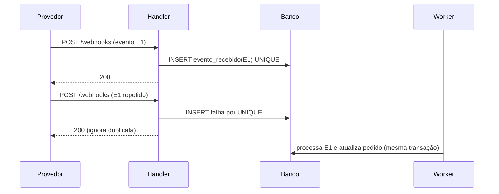

# Resiliência e consistência entre serviços

Validado em 2026-10-10 · Modelo-alvo: Claude 4.x/5.x · Rótulos: Verificado, Inferido, Suposição, Não verificável.
Fontes: Azure Architecture Center, padrões Retry (V-31), Circuit Breaker (V-30), Bulkhead (V-32), Idempotent Consumer (V-33), Transactional Outbox (V-34), Saga (V-35), CQRS (V-36), Event Sourcing (V-37); AWS Builders' Library, timeouts, retries e backoff com jitter (N-01); rascunho IETF do Idempotency-Key (N-03); V-41 (proyecto26, MIT); brain-of-agent (MIT). Todas as páginas da Microsoft: destilar, sem cópia literal. Taxonomia geral de event-driven: Inferido (lacuna 9).

## Sumário

1. Método: da falha parcial ao padrão
2. Retry
3. Circuit breaker
4. Bulkhead
5. Idempotent consumer
6. Transactional outbox
7. Saga
8. CQRS
9. Event sourcing
10. Event-driven: coreografia, orquestração, tipos de evento
11. Combinação segura e receitas
12. Testes que provam a propriedade
13. Gotchas

## 1. Método

1. Nomeie a falha parcial concreta: qual efeito já aconteceu, qual processo morreu, o que o chamador sabe.
2. Leia "quando NÃO usar" antes de escolher.
3. Aplique o checklist do padrão (sim, não, N.A.; template `resilience-sheet.md`).
4. Desenhe a sequência de falha (Mermaid `sequenceDiagram`) e escreva o teste que provaria a propriedade.
5. Declare o que não foi verificado. Nunca afirme "elimina duplicatas".

## 2. Retry (V-31, N-01)

Quando usar: falha transitória e operação idempotente. Quando NÃO: operação não idempotente; falha permanente; outra camada já repete.

Checklist (8):

- [ ] A falha é transitória? (503, timeout, conexão; 4xx de validação não é.)
- [ ] A operação é idempotente, ou tem chave de idempotência? Sem isso, não repita.
- [ ] O SDK ou cliente já repete? Verifique a configuração (V-31 manda verificar retry embutido).
- [ ] Limite de tentativas e orçamento total de tempo.
- [ ] Atraso exponencial com variação aleatória (jitter), para espalhar instâncias; para trabalhos agendados, N-01 admite deslocamento consistente por host.
- [ ] Só uma camada repete; a mais baixa falha rápido e as de cima propagam o erro.
- [ ] Logs: tentativas iniciais como informação, só a última como erro.
- [ ] Erro recorrente vira discussão de capacidade, não mais retry (retry não substitui escala).

Amplificação (N-01): com 5 camadas e 3 tentativas cada, a dependência pode receber até 3^5 = 243 vezes a carga original. É o motivo da regra "uma camada". Quando o breaker indica falha não transitória, o retry deve parar (V-30).

## 3. Circuit breaker (V-30)

Estados: fechado, aberto, meio-aberto. Contador de falhas por janela de tempo; no meio-aberto, poucas chamadas de teste; um erro reabre. Quando NÃO usar: estado local em memória; substituir tratamento de exceção de negócio; arquitetura orientada a mensagens com dead-letter queue (isolamento e retry já embutidos); recuperação feita pela plataforma (mesh, health checks).

Checklist (9):

- [ ] Limiar de falhas e janela definidos.
- [ ] Tempo aberto, com crescimento (timeout crescente).
- [ ] Número de chamadas de teste no meio-aberto.
- [ ] Fallback definido (valor padrão, cache, degradação explícita).
- [ ] Evento e alerta a cada transição.
- [ ] Reset manual e abertura forçada disponíveis.
- [ ] Um breaker por dependência ou shard (uma instância lenta não derruba o resto).
- [ ] O timeout do chamador é curto; timeout longo anula a proteção.
- [ ] Cabe aqui, ou o broker ou mesh já cobre? 429 e 503 podem abrir de imediato.

## 4. Bulkhead (V-32)

Isola recursos por dependência ou consumidor para que uma dependência lenta não esgote o recurso compartilhado. Quando NÃO: o uso menos eficiente de recursos é inaceitável, ou a complexidade não se justifica. Cargas de IA/inferência pedem bulkheads rígidos por cota (V-32).

Checklist (6):

- [ ] Quais dependências podem esgotar um recurso compartilhado (pool, threads, conexões)?
- [ ] Pool ou fila separada por dependência crítica; ou processos, contêineres, filas.
- [ ] Tamanho de cada pool vem de número medido (não chute).
- [ ] A plataforma já oferece o limite (limites de API gateway, cotas, limites de orquestrador)? Use em vez de recriar.
- [ ] Alerta e SLA por partição; partições alinhadas a bounded contexts.
- [ ] O custo de menor utilização foi aceito por escrito.

## 5. Idempotent consumer (V-33)

Fato central: exactly-once fim a fim é impraticável; at-least-once mais um consumidor que ignora duplicata dá efeito de uma vez só.

Checklist (8):

- [ ] Chave estável (MessageId ou chave de negócio), nunca CorrelationId nem ID de entrega; com identidade do consumidor quando vários consumidores compartilham a tabela.
- [ ] A operação já é naturalmente idempotente (upsert por chave)? Prefira.
- [ ] Marcador de processado e efeito na mesma transação (padrão Inbox).
- [ ] Restrição de unicidade no banco como árbitro de concorrência.
- [ ] Estados "em andamento" e "concluído" para efeito externo (não repetir cobrança em andamento).
- [ ] Retenção da chave maior que a janela de redelivery, inclusive reenvios de dead-letter.
- [ ] Métrica de duplicatas e chave nos logs; a deduplicação do broker não substitui o consumidor.
- [ ] Ordem tratada por sessão, partição ou versão quando importa; propagar a chave a serviços chamados.

## 6. Transactional outbox (V-34, item 7 corrigido)

Resolve o dual write: gravar o estado e o evento na mesma transação; processo separado publica e marca como processado. Quando NÃO: não há broker; o evento pode ser perdido sem dano.

Checklist (7):

- [ ] Estado e evento gravados na mesma transação (mesma tabela, ou mesmo contêiner e partição lógica em banco documental). Correção do item 7: o evento é persistido junto do estado, não fora da transação.
- [ ] Evento com ID estável.
- [ ] Publicador assíncrono com retomada após falha (lê pendentes, publica, marca).
- [ ] Ordem preservada por agregado (em SQL a ordem precisa ser garantida; em Service Bus, `SessionId`).
- [ ] Retenção/TTL com margem de dias.
- [ ] Consumidor idempotente (seção 5): o outbox dá at-least-once, não exactly-once.
- [ ] Biblioteca de outbox pronta (NServiceBus, MassTransit) avaliada antes de escrever o publicador; o exemplo da fonte não é código de produção.

Esquema mínimo (SQL genérico, ilustrativo):

```sql
-- Ilustrativo; adapte tipos e nomes ao seu SGBD
CREATE TABLE outbox (
  id            UUID PRIMARY KEY,          -- ID estável do evento
  aggregate_id  TEXT NOT NULL,             -- chave de ordenação
  type          TEXT NOT NULL,
  payload       JSONB NOT NULL,
  created_at    TIMESTAMP NOT NULL DEFAULT now(),
  published_at  TIMESTAMP NULL             -- NULL = pendente
);
-- No caso de uso: UPDATE do estado + INSERT INTO outbox na MESMA transação.
-- Publicador: SELECT ... WHERE published_at IS NULL ORDER BY created_at, publica, depois UPDATE published_at.
```

## 7. Saga (V-35)

Transações locais com compensações. Tipos de passo: compensáveis, pivô (ponto sem volta) e retentáveis depois do pivô (idempotentes). Coreografia: simples, difícil de rastrear e testar, risco de dependência cíclica. Orquestração: fluxos complexos, o orquestrador é ponto único de atenção. Quando NÃO: transações fortemente acopladas, compensação em participantes anteriores, dependências cíclicas.

Checklist (7):

- [ ] Cada passo tem compensação (ou é pivô/retentável, declarado).
- [ ] Pivô marcado; passos depois do pivô são idempotentes e retentáveis.
- [ ] Coreografia só com poucos serviços; senão orquestração.
- [ ] Bloqueio semântico (ex.: estado `pendente`) em registros em edição.
- [ ] Anomalias de isolamento tratadas (atualização perdida, leitura suja, leitura não repetível): bloqueio semântico, atualizações comutativas, visão pessimista, reler valores, versionar.
- [ ] Monitoração do estado da saga (idade, passo atual, falhas).
- [ ] Plano para compensação que falha (nova tentativa, alerta, intervenção manual).

## 8. CQRS (V-36): cinco perguntas

1. Leitura e escrita têm escala diferente?
2. As regras justificam um modelo de escrita próprio?
3. A interface é orientada a tarefas (comandos de negócio, não atualização de campo)?
4. O time aceita consistência eventual e dado obsoleto na tela?
5. Existe mecanismo de sincronização (outbox mais consumidor idempotente)?

Se (1) e (2) forem "não", não aplique. Separe primeiro no mesmo banco; só depois em bancos diferentes sincronizados por eventos. Consultas retornam DTOs sem lógica de domínio. Complexidade aumenta muito com event sourcing.

## 9. Event sourcing (V-37)

A página abre com aviso: padrão complexo, caro de adotar ou abandonar e raramente necessário. Checklist:

- [ ] O benefício (auditoria, reconstrução histórica) justifica o custo?
- [ ] Eventos capturam intenção, não só o estado resultante.
- [ ] Estratégia de evolução de esquema antes do primeiro evento (deserialização tolerante, versão no evento, upcasting; migração in-place só como último recurso).
- [ ] Concorrência otimista por fluxo; ordem por fluxo.
- [ ] Snapshots quando o fluxo cresce (otimização, não substituto do log).
- [ ] Dados pessoais fora do evento ou crypto-shredding (conflito com direito ao esquecimento).
- [ ] Handlers idempotentes; atenção a laços circulares.
- [ ] O event store não é broker (Kafka não substitui); aplicar só onde precisa (ledger de pagamentos sim, perfil de usuário não).

## 10. Event-driven: coreografia, orquestração, tipos de evento (Inferido)

A taxonomia abaixo é conhecimento geral; a fonte primária (Fowler 2017, AsyncAPI) não foi lida.

| Tipo de evento | Carrega | Risco |
| --- | --- | --- |
| Notificação | Só o fato e um ID (`PedidoPago {id}`) | Consumidor volta ao produtor para ler dados: acoplamento temporal |
| Transferência de estado | Dados suficientes para o consumidor agir | Contrato de esquema grande; versionamento obrigatório |
| Comando disfarçado de evento | Instrução ("EnviarEmail") | Acoplamento oculto; prefira comando explícito |

Escolha: coreografia quando poucos serviços e fluxo simples; orquestração quando o fluxo tem ramificações, compensações ou precisa de visibilidade (V-35). Registre o contrato do evento (nome, versão, chave de ordenação, chave de idempotência, política de evolução).

## 11. Combinação segura e receitas

Retry em uma camada, com limite e jitter, só com operação idempotente. Breaker por dependência, com timeout curto do chamador. Bulkhead por dependência crítica. Outbox com estado e evento na mesma transação. Consumidor idempotente com chave estável, marcador e efeito na mesma transação, TTL maior que redelivery e DLQ. Saga com pivô e passos pós-pivô idempotentes.

**Receita: webhook de pagamento** (caso de eval): o handler recebe o webhook, valida assinatura, grava `evento_recebido` com a chave do provedor (restrição de unicidade) e responde 2xx rápido; um worker processa a partir da tabela (outbox de entrada); o efeito no pedido é idempotente por chave de negócio; falhas voltam à fila com limite e DLQ; o provedor repete o webhook por conta própria, então só existe uma camada de retry do nosso lado (o worker).



**Receita: pedido com estoque e pagamento**: saga orquestrada (reservar estoque, cobrar, confirmar); pivô = cobrança aprovada; compensações = liberar estoque, estornar; cada comando com chave de idempotência; estado do pedido explícito (`rascunho`, `reservado`, `pago`, `cancelado`).

**Receita: consistência entre escrita e busca**: gravar no banco e publicar via outbox; o indexador de busca é consumidor idempotente; tolerância de atraso declarada (orçamento de obsolescência, ver `api-cache-escala.md`).

## 12. Testes que provam a propriedade

| Propriedade | Teste |
| --- | --- |
| Duplicata inofensiva | Enviar a mesma mensagem duas vezes e assertar um único efeito |
| Sem perda após commit | Matar o processo logo após o commit e assertar que o publicador retoma do outbox |
| Aceitação desconhecida | Simular timeout após o externo aceitar e assertar estado pendente, não falha definitiva |
| Compensação que falha | Falhar a compensação e assertar alerta e novo ciclo |
| Retry único | Contar tentativas na dependência com falha injetada: deve ser o limite de uma camada |
| Concorrência | Duas requisições simultâneas com a mesma chave produzem uma operação |

## 13. Gotchas

- O texto de Retry da Microsoft não menciona jitter; ele vem de N-01 e de V-41. Se citar a Microsoft para jitter, está errado.
- Pesquisadores iniciais escreveram que o evento do outbox fica fora da transação principal; a fonte diz o oposto (conflito C10, corrigido em V-34).
- Idempotency-Key HTTP: convenção usada em muitas APIs, sem RFC (rascunho expirado, N-03). Defina escopo, TTL e resposta repetida no contrato local.
- Bibliotecas citadas (NServiceBus, MassTransit) são do ecossistema .NET; em outras stacks procure o equivalente e avalie licença e manutenção.
- Números de V-41 (QPS por nó de cache e similares) são regras de bolso: Suposição.
- "Efetivamente uma vez" depende do consumidor; documentação que prometa exactly-once fim a fim deve ser reescrita.
- A saga de coreografia cresce em dependências cíclicas sem ninguém notar; desenhe o grafo de eventos antes de aprovar.
