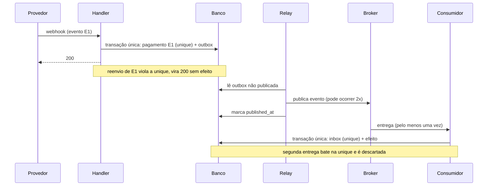

# Receitas combinadas de resiliência e consistência

Sumário: 1. Receita A: webhook de pagamento (dual write, duplicados, perda) · 2. Esquemas SQL ilustrativos · 3. Backoff com jitter (código) · 4. Receita B: pedido com saga · 5. Receita C: chamada a provedor com timeout de aceitação desconhecida · 6. Gotchas

Validado em 2026-10-10. Método: V-33, V-34, V-35, V-30 a V-32, N-01; exemplo antes/depois adaptado de `arquitetura-e-dominio.md` do brain-of-agent (MIT, Francisco Edson: débito, pagamento externo e outbox, sem afirmar que a outbox elimina duplicatas). Código e SQL são ilustrativos. O que foi executado: a lógica do marcador de idempotência (inbox) e a função de backoff foram executadas com `sqlite3` e Python em 2026-10-10 (Verificado); o DDL PostgreSQL abaixo **não** foi executado (Não verificável aqui: teste no seu SGBD). Nada aqui deve ser instalado ou executado pelo plugin.

## 1. Receita A: webhook de pagamento

**Problema (cenário típico).** Um handler recebe o webhook do provedor, grava o pagamento no banco e depois publica `PagamentoConfirmado` no broker. Há retry em cada camada (cliente, gateway, job). Sintomas: pedidos duplicados e eventos perdidos.

**Falhas parciais (frases no formato "se X entre A e B").**
- Se o processo cair entre gravar e publicar, o evento se perde (dual write).
- Se o provedor reenviar o webhook (ele repete quando não recebe 2xx a tempo), o handler grava duas vezes.
- Se três camadas repetem a mesma chamada, a carga e as duplicatas se multiplicam.

**Design recomendado.**
1. Webhook: validar assinatura (conforme documentação do provedor), extrair o id do evento do provedor (chave estável) e gravar `pagamento` e `outbox` na **mesma transação**. Responder 2xx logo; processar o resto de forma assíncrona.
2. Idempotência na borda: a restrição de unicidade em `(provedor, id_do_evento)` descarta o reenvio do webhook sem efeito.
3. Relay da outbox publica no broker (at-least-once), marcando `published_at`; pode publicar duas vezes.
4. Consumidores usam marcador `inbox` na mesma transação do efeito; duplicata é descartada.
5. Retry em uma só camada (o relay, ao falhar a publicação), com limite, atraso exponencial com variação aleatória; as demais camadas falham sem repetir.
6. Breaker e timeout curto nas chamadas ao provedor; bulkhead (pool próprio) para o provedor de pagamento.



**O que a receita não promete.** Não elimina duplicatas no broker; não garante ordem global; não torna o provedor idempotente. Se o provedor aceita e não responde (timeout), veja a receita C.

## 2. Esquemas SQL ilustrativos (PostgreSQL, não executados)

```sql
-- Pagamento com unicidade pelo id do evento do provedor
CREATE TABLE pagamento (
  id            bigserial PRIMARY KEY,
  provedor      text        NOT NULL,
  evento_id     text        NOT NULL,
  pedido_id     text        NOT NULL,
  valor_centavos bigint     NOT NULL,
  criado_em     timestamptz NOT NULL DEFAULT now(),
  UNIQUE (provedor, evento_id)
);

-- Outbox: gravada na mesma transação do estado
CREATE TABLE outbox (
  id           bigserial PRIMARY KEY,
  event_id     uuid        NOT NULL UNIQUE,
  agregado_id  text        NOT NULL,
  tipo         text        NOT NULL,
  payload      jsonb       NOT NULL,
  criado_em    timestamptz NOT NULL DEFAULT now(),
  published_at timestamptz
);

-- Inbox: marcador do consumidor idempotente
CREATE TABLE inbox (
  consumidor   text        NOT NULL,
  message_id   text        NOT NULL,
  recebido_em  timestamptz NOT NULL DEFAULT now(),
  PRIMARY KEY (consumidor, message_id)
);
```

Consumidor (pseudo-SQL; a lógica foi validada em sqlite3):

```sql
BEGIN;
INSERT INTO inbox (consumidor, message_id) VALUES ('faturamento', :message_id)
  ON CONFLICT DO NOTHING;            -- 0 linhas afetadas = duplicata
-- se 0 linhas: ROLLBACK; confirmar (ack) a mensagem e parar
-- senão: aplicar o efeito de negócio na MESMA transação
COMMIT;                              -- só então ack no broker
```

Relay da outbox (um publicador por partição de agregado preserva a ordem; vários publicadores concorrentes sobre as mesmas linhas, por exemplo com `FOR UPDATE SKIP LOCKED`, quebram a ordem por agregado):

```sql
SELECT id, event_id, tipo, payload FROM outbox
 WHERE published_at IS NULL ORDER BY id LIMIT 100;
-- publicar cada evento; depois: UPDATE outbox SET published_at = now() WHERE id = :id;
```

Retenção: limpar `outbox` publicada e `inbox` antiga só depois de um prazo maior que o redelivery do broker e o reprocessamento da DLQ (V-33, V-34).

Efeito externo no consumidor (e-mail, cobrança): acrescente `status` (`em_andamento`, `concluido`) ao marcador e um prazo (lease) para retomar quando o processo cair no meio; sem isso, o crash após o efeito e antes do COMMIT repete o efeito externo (V-33).

## 3. Backoff com jitter

Espera aleatória entre 0 e `min(teto, base x 2^tentativa)` (variante conhecida como "full jitter"; Inferido: nome de conhecimento geral, o artigo N-01 trata de jitter e retry em uma camada). Testada em Python 3 em 2026-10-10 com valores determinísticos (Verificado).

```python
import random

def backoff_delay(attempt: int, base: float = 0.2, cap: float = 10.0, rng=random.random) -> float:
    """Segundos de espera antes da próxima tentativa (attempt começa em 0)."""
    return rng() * min(cap, base * (2 ** attempt))
```

Uso: `for attempt in range(max_attempts): try: return call() except Transitorio: sleep(backoff_delay(attempt))`, respeitando o prazo total e `Retry-After`. Para trabalho agendado em muitos hosts, um deslocamento fixo por host evita rajadas sincronizadas (N-01). Valores de `base`, `cap` e `max_attempts` são Suposição.

## 4. Receita B: pedido com saga

Fluxo: reservar estoque -> cobrar pagamento -> criar envio. Cada passo é uma transação local no seu serviço.

| Passo | Compensação | Observação |
| --- | --- | --- |
| 1. Reservar estoque | Liberar reserva | Compensável |
| 2. Cobrar pagamento | Estornar | Pivô: depois da cobrança bem-sucedida o fluxo caminha para a frente |
| 3. Criar envio | Nenhuma (retentável) | Pós-pivô: idempotente, repetido até concluir |

Regras (V-35): orquestração se houver mais de poucos serviços; bloqueio semântico (pedido em `pendente` enquanto a saga corre); instâncias presas monitoradas com prazo máximo; plano explícito se o estorno falhar (repetir, alertar, fila de intervenção manual); toda mensagem da saga é idempotente (consumidor com inbox). Se os passos 1 e 2 vivem no mesmo banco, uma transação local basta e a saga é dispensável (quando NÃO usar).

## 5. Receita C: timeout com aceitação desconhecida

O chamador não sabe se o provedor processou. Repetir cegamente pode cobrar duas vezes.

1. Envie sempre uma chave de idempotência ao provedor quando ele a suportar (conferir a documentação dele: Não verificável aqui); a repetição com a mesma chave devolve o resultado original.
2. Sem suporte à chave: consulte o estado por um identificador do pedido antes de repetir; se não for possível consultar, marque o pagamento como `incerto` e leve à conciliação (humana ou automática), em vez de repetir.
3. O timeout do chamador é curto o bastante para o breaker proteger e longo o bastante para não abortar chamadas normais; meça a latência real (p99) antes de fixar.
4. Teste: simular resposta perdida (o provedor falso processa e não responde) e verificar que há um só efeito.

## 6. Gotchas

- Publicar antes de gravar ("publica e depois grava") só troca perda de evento por evento fantasma (evento sem estado).
- `ON CONFLICT DO NOTHING` sem checar linhas afetadas processa o efeito mesmo na duplicata.
- Ack no broker antes do COMMIT perde a mensagem se o processo cair entre os dois.
- Outbox e inbox crescem sem limite se ninguém limpa: planeje a retenção.
- Teste só com o broker em memória não prova redelivery real: veja a matriz em [testes-de-falha.md](testes-de-falha.md).
