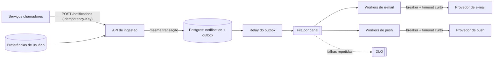

# Exemplo de design doc: serviço de notificações

Sumário: 1. Pedido · 2. Design doc · 3. O que o exemplo demonstra

Exemplo ilustrativo; todos os números são premissas rotuladas Suposição. Tecnologias aparecem como exemplos, não como recomendação de fornecedor. Fontes de método: V-41, V-38, V-33, V-34, V-30 a V-32, V-23.

## 1. Pedido

> "Projete um serviço de notificações (e-mail + push) para 2 milhões de usuários, 50 mil envios por minuto no pico, com retentativas."

## 2. Design doc

### Contexto e objetivo
Serviço interno que recebe pedidos de notificação de outros serviços e os entrega por e-mail e push, com retentativas seguras e sem duplicar envios visíveis ao usuário.

### Requisitos
- Funcionais: receber pedido (usuário, canal, template, dados); respeitar preferências do usuário; entregar por e-mail e push; consultar o status; cancelar envio ainda não despachado.
- Não funcionais (todos Suposição, a confirmar): pico de 50.000 envios/min (informado); entrega de 95% em até 1 minuto no pico; sem perda de pedido aceito; duplicado visível ao usuário é raro e tolerável apenas em falha de provedor; disponibilidade da API de ingestão 99,9% (Suposição).

### Estimativa (premissa -> conta -> resultado)
- Pico: 50.000/min / 60 = 833 envios/s (informado).
- Média: 2 milhões x 3 notificações/dia (Suposição) = 6 milhões/dia / 86.400 = 69 envios/s. Pico/média ≈ 12x.
- Armazenamento: 6 milhões x 500 B por registro (Suposição) = 3 GB/dia; 30 dias de retenção = 90 GB; x2 com réplica = 180 GB, mais índices.
- Banda de saída ao provedor: mix 50% push de 1 KB e 50% e-mail de 30 KB (Suposição) = 15,5 KB médios; 833 x 15,5 KB ≈ 12,6 MB/s ≈ 100 Mbit/s.
- Concorrência em voo (lei de Little): 833/s x 0,2 s de latência do provedor (Suposição) ≈ 167 chamadas simultâneas. Com 50 chamadas simultâneas por processo (Suposição, medir) = 4 processos; com margem 2x = 8 workers.
- Retentativas: 5% de falha transitória x até 2 tentativas extras = até +10% de carga ≈ 917/s no pior caso.
- Queda de provedor por 10 min no pico: 50.000/min x 10 = 500.000 mensagens x 2 KB ≈ 1 GB de backlog. Fila e armazenamento comportam; o prazo de 1 minuto não.
- Premissa que mais move o resultado: latência do provedor (dobrar dobra a concorrência em voo).

### Diagrama (um nível, 11 nós)

Verificação do diagrama: 11 nós, um nível, rótulos curtos. O parse real do Mermaid não foi executado (Não verificável aqui); a sintaxe foi relida à mão.

### Componentes (motivo e custo)
| Componente | Motivo | Custo |
| --- | --- | --- |
| API de ingestão (um serviço, módulos internos) | Valida, aplica preferências, grava pedido e outbox na mesma transação; devolve 202 | Um deploy a operar |
| Postgres (`notification` + `outbox`) | Estado e evento na mesma transação (V-34); consultas de status | Limite de escrita de um primário; 833/s está confortável para PK/insert (Suposição, medir) |
| Relay do outbox | Publica na fila e marca como publicado; at-least-once | Pode publicar duplicado após falha: consumidor idempotente |
| Fila por canal | Isola e-mail de push (bulkhead, V-32); absorve pico | Serviço gerenciado a operar; ordem não garantida |
| Workers por canal | Consomem, chamam o provedor com timeout curto e breaker por provedor (V-30) | Escala por concorrência em voo |
| DLQ | Mensagens que falharam repetidamente; alerta e reprocesso manual | Exige alerta e dono |

### Fluxo de dados
1. Chamador envia `POST /notifications` com `Idempotency-Key`. A API valida, consulta preferências, grava `notification` (status `pendente`) e `outbox` na mesma transação, responde 202 com o id.
2. O relay lê a outbox em ordem, publica na fila do canal e marca como publicada. Falha entre publicar e marcar gera duplicado na fila (esperado).
3. O worker consome, grava um marcador `(consumidor, notification_id)` na mesma transação que muda o status para `enviando`; duplicado é descartado (V-33). Estados em andamento/concluído protegem o efeito externo.
4. Chama o provedor com timeout curto; sucesso muda para `enviado`. Timeout é aceitação desconhecida: consulta o provedor pela chave de idempotência do envio, se existir; senão marca `incerto` e segue a política (reenvio apenas se o provedor deduplica).
5. Falha transitória: uma só camada de retry (o worker, com o breaker aberto o retry para), atraso exponencial com variação aleatória e no máximo 3 tentativas; depois, DLQ.

### Trade-offs
| Decisão | Ganho | Custo | Alternativa mais simples |
| --- | --- | --- | --- |
| Assíncrono com fila | Absorve pico; isola provedor lento | Consistência eventual no status | Envio síncrono no request: simples, mas acopla latência do provedor ao chamador |
| At-least-once + consumidor idempotente | Nenhum pedido aceito é perdido | Duplicado possível em falha de provedor | Fire-and-forget: pode perder pedidos |
| Um serviço com módulos | Operação simples para o volume | Escala junta | Microsserviços por canal: sem requisito que os justifique |
| Postgres como fonte de estado | Transação e consultas | Limite de escrita vertical | Banco chave-valor: não é necessário no volume estimado |

### Modos de falha
| Dependência | Falha | Comportamento | Detecção |
| --- | --- | --- | --- |
| Provedor de e-mail | Lento ou fora | Breaker abre; mensagens ficam na fila; push não é afetado | Métrica de latência e de estado do breaker; alerta de backlog |
| Fila | Indisponível | A API continua aceitando (outbox acumula); relay retoma | Alerta de idade da outbox |
| Postgres primário | Indisponível | API responde 503; nenhum pedido é aceito sem persistir | Health check; alerta |
| Worker cai após enviar, antes de marcar | Reentrega | Provedor deduplica por chave se suportar; senão duplicado raro | Métrica de duplicatas por reentrega |
| Preferências indisponíveis | Leitura falha | Falha fechada: não enviar notificação não essencial; decisão do produto | Erro por tipo |

### O que não construir agora
- Kafka ou streaming dedicado: 833/s cabe em fila gerenciada (Suposição, medir).
- Microsserviços por canal: sem requisito de times ou escala independentes.
- Cache de preferências: leitura por chave primária no mesmo banco; reavaliar com métrica (V-38, V-41).
- Prioridades em vários níveis e multirregião: sem requisito declarado.
- Motor de templates próprio: usar o do provedor ou biblioteca consolidada.

### Decisões pendentes (dono humano)
| Decisão | Dono | Observação |
| --- | --- | --- |
| Provedores e limites de taxa contratados | responsável de plataforma | Não verificável aqui: conferir contrato |
| Meta de entrega (p95 em 1 min?) | produto | Muda o dimensionamento de workers |
| Política em timeout sem deduplicação no provedor | produto e engenharia | Risco de duplicado vs perda |
| Retenção de registros (30 dias?) | produto, jurídico | Dados pessoais |

### Riscos
- Limites dos provedores podem ser menores que 833/s (Não verificável).
- Consistência eventual no status pode confundir quem consulta logo após o POST.
- Estimativas de latência e de tamanho são Suposições: medir em um piloto antes de decidir infraestrutura.

### Próximo passo
Revisar com `design-review`, registrar ADR de fila e de política de timeout, e rodar um piloto de carga no ambiente do time (comando e ferramenta a escolher pelo time).

## 3. O que o exemplo demonstra

- Estimativa no texto, com premissas e a premissa dominante.
- Diagrama pequeno, um nível; componentes com motivo e custo.
- At-least-once com consumidor idempotente em vez de promessa de exactly-once.
- Lista explícita do que não construir e das decisões que são humanas.
