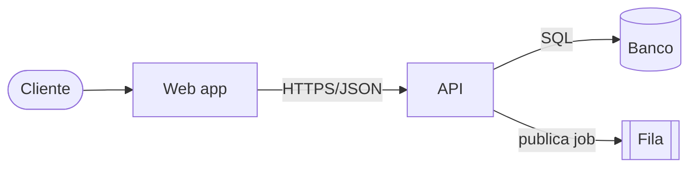
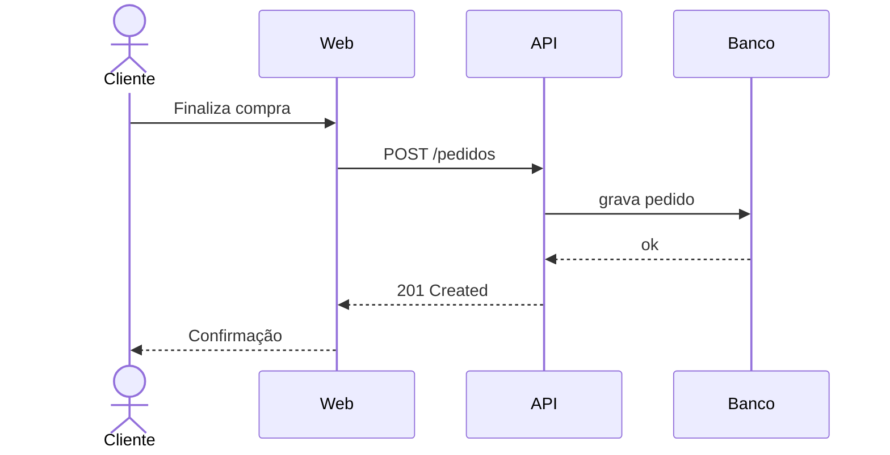
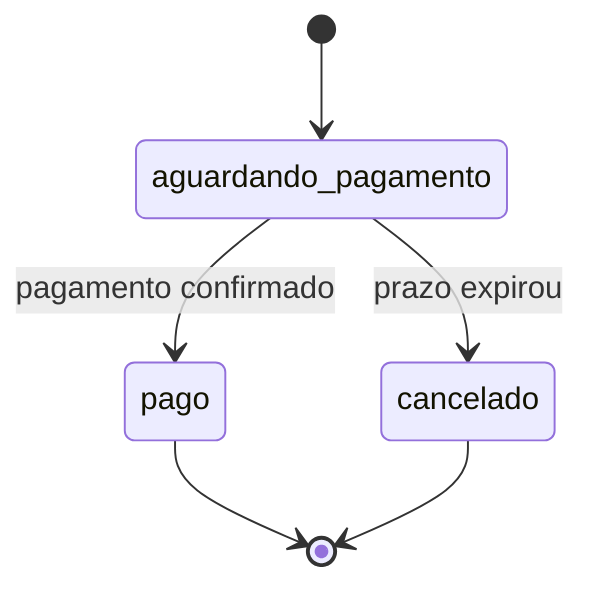
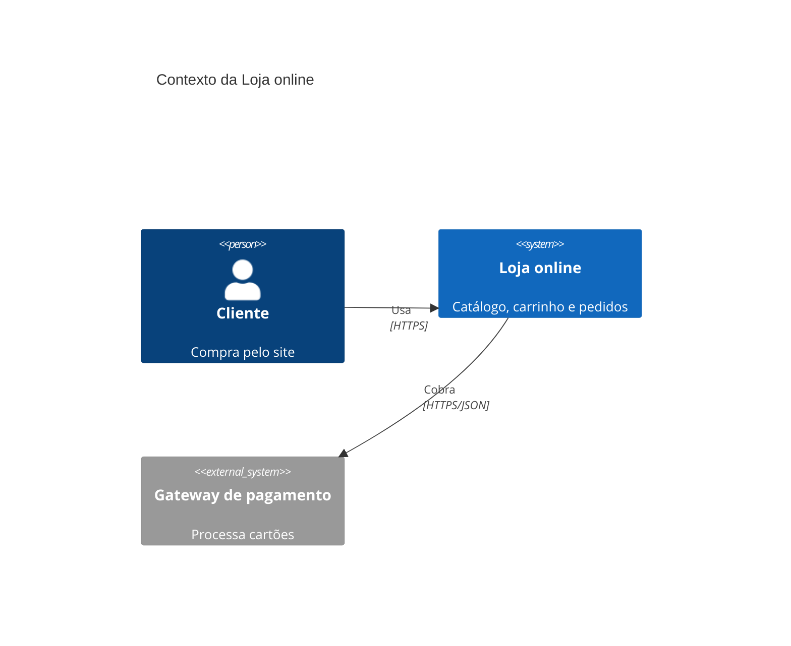
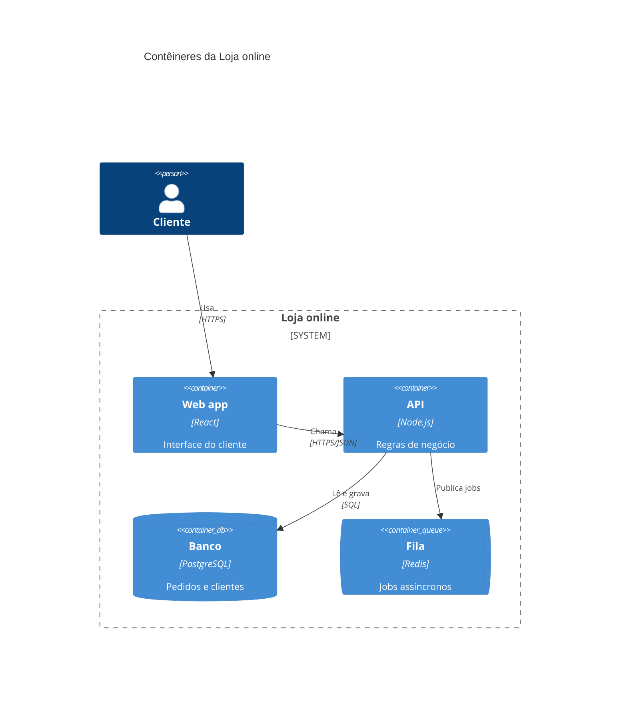
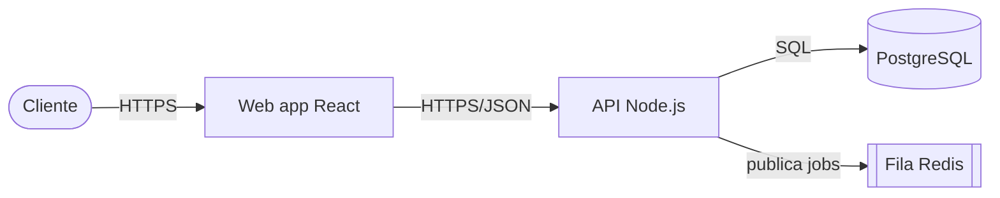

# Guia de Mermaid e C4 para documentação

Conteúdo: 1 necessidade → tipo · 2 esqueletos · 3 C4 em níveis · 4 teste de renderização · 5 exemplo completo com fallback · 6 versões e fontes.

Fontes: documentação do Mermaid (https://mermaid.js.org/intro/ e /syntax/c4.html), documentação do GitHub sobre diagramas, modelo C4 de Simon Brown (CC BY 4.0), skill `c4-architecture` do softaworks/agent-toolkit (MIT) como inspiração de níveis, regra de menos de 15 nós do exemplo de output style da Anthropic. Itens V-21, V-22, V-44, V-08. Rótulo: Verificado nas fontes citadas; os esqueletos abaixo são redação própria **não renderizada** na construção (sem Mermaid disponível); sintaxe de macros C4 conferida contra a documentação lida (macros `Person`, `System`, `System_Ext`, `Container`, `Component`, `Boundary`, `Rel`) e, para `ContainerDb`, `ContainerQueue` e `System_Boundary`, Inferida do conhecimento estável do Mermaid. Confirme em /syntax/c4.html.

## 1. Necessidade → tipo

| Necessidade | Tipo Mermaid | Observação |
| --- | --- | --- |
| Decisão, processo, dependências | `flowchart TD` ou `LR` | O mais portátil; use como fallback |
| Interação entre partes no tempo | `sequenceDiagram` | Um cenário por diagrama |
| Ciclo de vida de uma entidade | `stateDiagram-v2` | Estados e eventos |
| Cronograma | `gantt` | Datas ISO |
| Modelo de tipos | `classDiagram` | Só relações relevantes |
| Modelo de dados | `erDiagram` | **Experimental**; modelagem é de `database-data-modeling` |
| Contexto do sistema | `C4Context` | **Experimental** |
| Contêineres | `C4Container` | **Experimental** |
| Componentes | `C4Component` | **Experimental**, só quando agrega |

Limite: menos de 15 nós por diagrama (preferência do plugin; Suposição de que vale em geral).

## 2. Esqueletos

Fluxo:



Sequência:



Estados:



Regras: `flowchart` formas `[ ]` retângulo, `([ ])` estádio, `[( )]` cilindro (banco), `[[ ]]` sub-rotina (fila); rótulo de aresta `-->|texto|`. Aliases sem espaço. Aspas em rótulos com caracteres especiais (parênteses, dois-pontos).

## 3. C4 em níveis

Níveis (V-21): contexto · contêineres · componentes · código; complementares: dinâmico e implantação. Notação e ferramenta são independentes: escolha uma e mantenha. Palavras-chave do Mermaid: `C4Context`, `C4Container`, `C4Component`, `C4Dynamic`, `C4Deployment`.

Contexto:



Contêineres:



Regras: um nível por figura; cada `Rel` com tecnologia ou intenção; pessoas e sistemas externos só no contexto e no que interage com o nível atual.

## 4. Teste de renderização

| Destino | Como testar | Resultado a registrar |
| --- | --- | --- |
| GitHub | Preview do arquivo (ou PR de teste); bloco com apenas `info` mostra a versão do Mermaid | "Verificado pelo usuário no GitHub, Mermaid <versão>, em <data>" |
| MkDocs, Docusaurus | Confirme o plugin de Mermaid no config e abra o preview local | idem, com o destino |
| Outro | Peça ao usuário o preview | "render não verificado" se não houver |

Bloco de versão (GitHub):

````markdown
```mermaid
info
```
````

C4 renderizado no GitHub: **Não verificado** (a página do GitHub lista fluxogramas, sequência e pizza "e mais", sem citar C4). Se falhar, use o fallback.

## 5. Exemplo completo (pedido: C4 de contêineres para o README do GitHub)

Arquivo `docs/architecture/containers-loja.md` (dados fictícios; no uso real, cada contêiner vem de arquivo lido):

````markdown
# Contêineres da Loja online

Público: desenvolvedores da equipe · Nível: contêineres (C4) · Data: 2026-10-10
Render: não verificado no GitHub (C4 do Mermaid é experimental; Mermaid <versão>)

**O que este diagrama mostra:** as quatro peças que a equipe opera e como falam entre si.
**O que não mostra:** pagamento externo, implantação e componentes internos da API.

(bloco C4Container da seção 3 aqui)

**Elementos Inferidos:** a fila Redis foi deduzida de `docker-compose.yml:14` (serviço `redis`)
e não há consumidor identificado no código lido.

## Alternativa (se o C4 não renderizar)

(bloco flowchart com os mesmos 5 elementos e as mesmas arestas)

Relacionados: `contexto-loja.md` (nível acima, quando existir)
````

Fallback com a mesma informação:



Contagem: 5 nós, abaixo do limite de 15.

## 6. Versões e onde conferir

- Mermaid: releases em https://github.com/mermaid-js/mermaid/releases (a verificação deste plugin viu releases de 2026-10-02); sintaxe C4 em https://mermaid.js.org/syntax/c4.html.
- GitHub: https://docs.github.com/en/get-started/writing-on-github/working-with-advanced-formatting/creating-diagrams.
- C4: https://c4model.com/.
