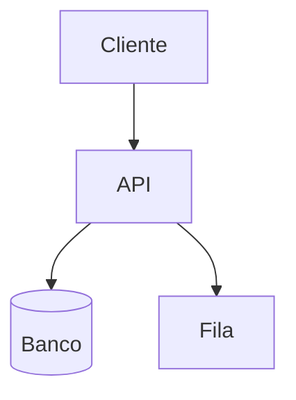
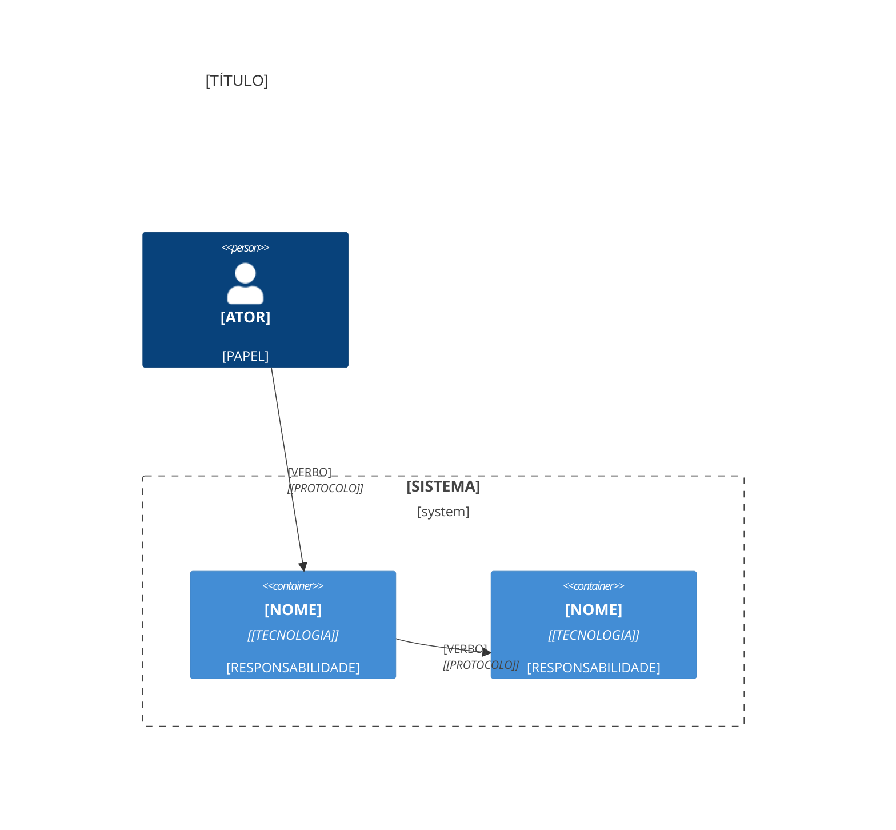

# Template: diagrama Mermaid (documentação de arquitetura)

Fontes: Mermaid (V-22), página do Mermaid sobre C4 e documentação do GitHub sobre diagramas (V-44), modelo C4 de Simon Brown (CC BY 4.0, V-21). Regras: um nível por diagrama; menos de 15 nós (calibragem vinda de um exemplo oficial de output style, não limite da ferramenta); texto acompanhante; **testar o render no destino antes de prometer**. C4 do Mermaid é **experimental** (a sintaxe pode mudar) e a página do GitHub não cita C4: se não renderizar, use `flowchart` com a mesma informação. Gravar em `docs/architecture/`.

## Necessidade → tipo

| Necessidade | Tipo |
| --- | --- |
| Fluxo de decisão, arquitetura simples | `flowchart` |
| Interação entre partes no tempo | `sequenceDiagram` |
| Ciclo de vida | `stateDiagram` |
| Cronograma | `gantt` |
| Modelo | `classDiagram` |
| Contexto, contêineres, componentes (C4) | `C4Context`, `C4Container`, `C4Component` (experimental) |

## Arquivo-modelo

````markdown
# [TÍTULO DO DIAGRAMA]

**Público:** [QUEM LÊ]. **Nível:** [contexto | contêineres | componentes | fluxo | sequência]. **Data:** [AAAA-MM-DD]. **Mermaid:** [VERSÃO USADA/TESTADA].

[Dois ou três parágrafos: o que o diagrama mostra, o que ele deixa de fora, e quais fatos foram Verificados (código lido) ou Inferidos.]



**Render:** [verificado pelo usuário em [DESTINO] | render não verificado].
````

## Esqueleto C4 de contêineres (experimental)

````markdown

````

Macros verificadas na documentação do Mermaid: `Person`, `System`, `System_Ext`, `Container`, `Component`, `Boundary`, `Rel`, `BiRel`. Confirme a sintaxe atual em https://mermaid.js.org/syntax/c4.html.

## Teste de render no GitHub

1. Peça ao usuário para abrir o preview do arquivo (ou um PR de teste).
2. Para ver a versão do Mermaid do GitHub, coloque num bloco `mermaid` apenas a palavra `info`.
3. Se o C4 não renderizar: `flowchart` equivalente.
4. Sem como testar: escreva "render não verificado" no arquivo.
