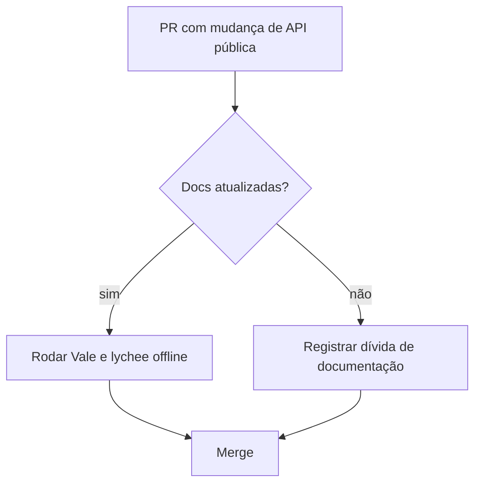
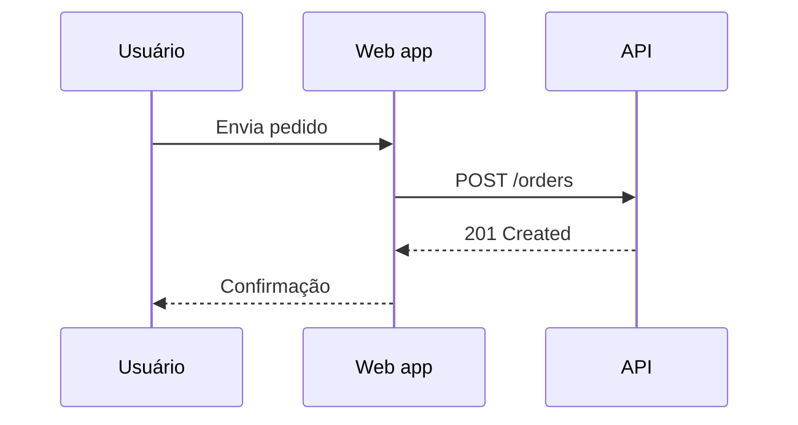
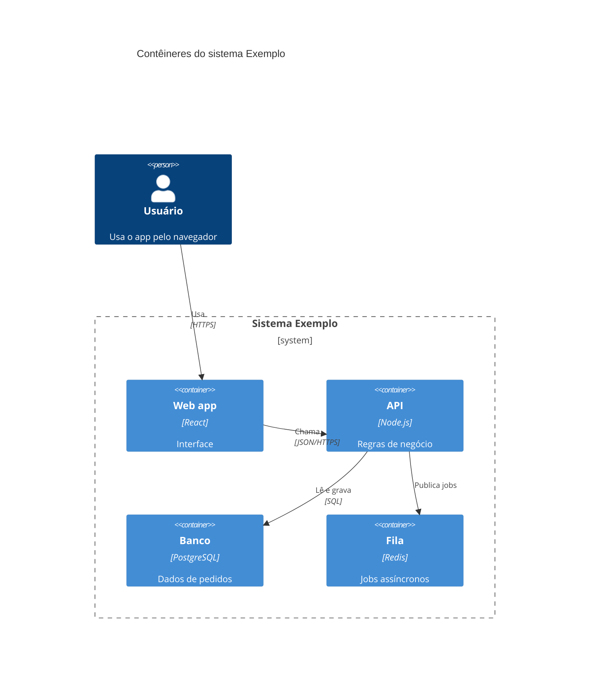

# Docs-as-code e diagramas

Validado em 2026-10-10 (V-21, V-22, V-37 a V-40, V-44). Versões das ferramentas mudam: Vale v3.24.0 (2026-10-01), vale-action v3.0.0 (2026-08-03), lychee v0.24.2 e lychee-action v2.9.0 (2026-07-09), markdownlint v0.41.1 (2026-07-13), Mermaid com releases em 2026-10-02. Confira as versões no repositório do usuário antes de escrever YAML. Nenhuma ferramenta foi executada nesta etapa; o que depende de execução está rotulado.

## Sumário

1. Princípio: o que é pedido e o que é garantia
2. Vale
3. markdownlint
4. lychee: dois jobs de links
5. Pipeline com GitHub Pages
6. Segurança do workflow
7. Mermaid: necessidade → tipo
8. C4 em níveis e o aviso de experimental
9. Teste de render e fallback
10. Exemplos de diagrama

## 1. Princípio

Instrução em CLAUDE.md é pedido; Vale, markdownlint e lychee em CI são garantia (V-01, V-15). O agente entrega os arquivos de configuração e o YAML **como texto ou arquivo local**; alterar CI do repositório pede confirmação concreta do usuário. Rodar linter executa software instalado no projeto: peça autorização e, sem execução, escreva "não executado".

## 2. Vale (V-37, MIT)

Linter de prosa que entende marcação. Tipos de regra (checks): existence, substitution, occurrence, repetition, consistency, conditional, capitalization, metric, readability, spelling, sequence, script. `extends` entre regras exige Vale 3.20.0 ou superior.

`.vale.ini` mínimo (campos verificados: `StylesPath`, `Packages`, `Vocab`, `MinAlertLevel` com `suggestion|warning|error`, seções por glob com `BasedOnStyles`):

```ini
StylesPath = styles
MinAlertLevel = warning
Packages = Google
Vocab = Projeto

[*.md]
BasedOnStyles = Vale, Google
```

- `vale sync` baixa os pacotes (estilos de terceiros com **licenças próprias**: confira antes de redistribuir).
- **Uma seção posterior que casa substitui `BasedOnStyles`, não soma.**
- Vocabulário do projeto vai em `Vocab`, em vez de desligar regras.
- Estilos em inglês (Google, Microsoft) em texto PT-BR geram ruído: para português, use regras próprias (`existence` para palavras de enchimento) e desative o que não se aplica (Suposição).
- Action `vale-cli/vale-action@v3` (movida de `errata-ai/vale-action`; fixar por SHA): `files` (padrão `all`), `reporter` (`github-pr-check`, `github-pr-review`, `github-check`), `fail_on_error` (padrão `false`), `config`, `filter_mode` (padrão `added`: só acusa linhas novas), `version` (padrão `latest`, mínimo 2.16.0). Mantenha `fail_on_error: false` até limpar o histórico; depois `true`.

Template: [vale-ini-e-workflow](../assets/templates/vale-ini-e-workflow.md).

## 3. markdownlint (V-38, MIT)

Configuração em `.markdownlint.json`: objeto que mapeia regra ou tag para `false`, `true`, `"error"`, `"warning"` ou objeto de opções; a chave `default` define a base; chaves processadas de cima para baixo; `extends` carrega base. Supressões por comentário HTML: `markdownlint-disable`, `-enable`, `-line`, `-next-line`, `-file`, `capture`, `restore`.

Perfil recomendado: padrão ligado; desligamentos só com motivo e data (mesma convenção das regras de agente); suprimir no trecho, não no arquivo inteiro; rodar localmente e em CI com o mesmo arquivo. CLIs: `markdownlint-cli2` e `markdownlint-cli` (o README não recomenda uma). O **comando exato do cli2 em CI é Não verificado**; `npx` baixa pacotes da rede: prefira dependência fixada no projeto.

## 4. lychee: dois jobs de links (V-39, Apache-2.0 ou MIT)

| Job | Quando | Flags | Bloqueia PR? |
| --- | --- | --- | --- |
| Offline | todo PR | `--offline` (só arquivos locais e âncoras; opção `--include-fragments` com `none`, `anchor-only`, `text-only`, `full`) | sim (rápido e determinístico) |
| Online | agendado (cron) | `--cache`, `fail: false`, abre issue com o relatório | não (links externos oscilam) |

`--offline` está confirmado na documentação da CLI, mas **a combinação via `args` da lychee-action é Inferida** (não testada). Inputs da action: `args`, `fail`, `format`, `output`, `jobSummary`, `token`, `lycheeVersion`, `debug`, `failIfEmpty`, `workingDirectory`. Também: `--exclude` (regex), `--accept-timeouts`. O exemplo oficial abre issue com `peter-evans/create-issue-from-file@v5` (action de terceiro: fixar por SHA e revisar). O README da lychee-action recomenda fixar por hash de commit.

## 5. Pipeline com GitHub Pages (V-40)

1. **Em PR:** Vale, markdownlint, lychee offline e **build sem deploy**.
2. **No branch padrão:** build e deploy com o ambiente protegido (`github-pages` é criado automaticamente; o GitHub recomenda regra de proteção para só o branch padrão publicar).
3. O deploy é **pulado em pull request** (Verificado). Fluxo com `actions/upload-pages-artifact` e `actions/deploy-pages`; **versões exatas Não verificadas**: leia o template atual do GitHub.
4. Antes de publicar, rode o job de PR e relate o que rodou e o que não rodou, sem afirmar que passou.

Template: [workflow-docs-ci](../assets/templates/workflow-docs-ci.md).

## 6. Segurança do workflow (Inferido das práticas do GitHub; conferir o template atual)

- Gatilho `pull_request`, não `pull_request_target`, em PR de fork.
- `permissions` mínimas por job: `contents: read` no lint; permissões de Pages só no job de deploy.
- Actions de terceiros fixadas por SHA com comentário da versão (recomendação Verificada no README da lychee-action).
- Nenhum segredo em jobs de PR de fork.

## 7. Mermaid: necessidade → tipo (V-22, V-44)

| Necessidade | Tipo |
| --- | --- |
| Fluxo de decisão ou arquitetura simples | `flowchart` |
| Interação entre partes ao longo do tempo | `sequenceDiagram` |
| Ciclo de vida | `stateDiagram` |
| Cronograma | `gantt` |
| Modelo de classes | `classDiagram` |
| Contexto, contêineres ou componentes (C4) | `C4Context`, `C4Container`, `C4Component` (**experimental**) |

Regras: bloco cercado com `mermaid`; **um nível por diagrama**; **menos de 15 nós** (limiar vindo de um exemplo oficial de output style: calibragem, não limite da ferramenta); texto acompanhante explicando o que o diagrama mostra, para quem e a data; gravar em `docs/architecture/`. ER é marcado como experimental na página do Mermaid.

## 8. C4 em níveis (V-21, CC BY 4.0, destilado)

Quatro níveis: contexto, contêineres, componentes, código; complementares: panorama do sistema, dinâmico, implantação. Independente de notação. Escolha o nível pelo **público**; não misture níveis (Inferido da estrutura); mantenha uma notação. Mermaid C4: palavras-chave `C4Context`, `C4Container`, `C4Component`, `C4Dynamic`, `C4Deployment`; macros `Person`, `System`, `System_Ext`, `Container`, `Component`, `Boundary`, `Rel`, `BiRel` e variantes direcionais. **A página do Mermaid diz que C4 é experimental** (sintaxe pode mudar): registre a versão usada.

## 9. Teste de render e fallback (V-44)

O GitHub renderiza Mermaid em bloco cercado com `mermaid`. A página do GitHub fala em fluxogramas, sequência e pizza "e mais", **sem lista de tipos e sem citar C4**; plugins de terceiros podem dar erro. Para saber a versão do Mermaid do GitHub, coloque `info` num bloco `mermaid` e veja o preview.

1. Escreva o diagrama. 2. Peça ao usuário para ver o preview do arquivo no destino (ou abrir PR de teste). 3. Se o C4 não renderizar, caia para `flowchart` com a mesma informação. 4. Sem como testar: escreva "render não verificado". C4 renderizado no GitHub continua **Não verificado** (G-04).

ASCII só como fallback quando o renderizador não é confirmado (C-10). PlantUML existente: edite no formato atual, sem instalar renderizador nem migrar para Mermaid sem pedido; registre "render não verificado".

## 10. Exemplos de diagrama

Fluxo de decisão (`flowchart`):

````markdown

````

Sequência (`sequenceDiagram`):

````markdown

````

C4 de contêineres (experimental; macros da lista verificada; confira a sintaxe em mermaid.js.org/syntax/c4.html):

````markdown

````

Esses exemplos não foram renderizados nesta etapa (render não verificado). Template: [diagrama-mermaid](../assets/templates/diagrama-mermaid.md).
