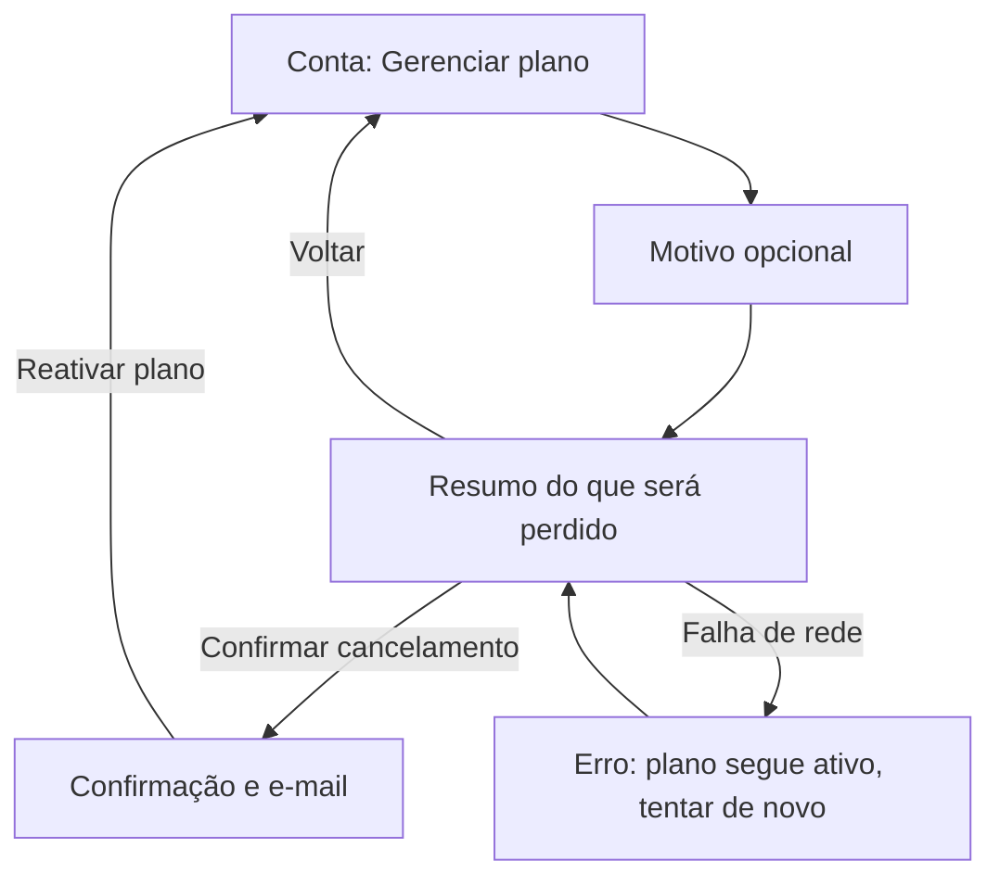

# Modo `fluxo`: mapa de fluxo e wireframe de baixa fidelidade

Use antes de desenhar as telas de um fluxo novo (cadastro, checkout, onboarding, cancelamento). A saída segue o template [T-12](${CLAUDE_PLUGIN_ROOT}/skills/playbook/assets/templates/fluxo-de-tela.md).

Rótulo de evidência: o conteúdo deste modo é conhecimento estável do domínio, rotulado Inferido. A pesquisa do segmento não encontrou fonte A ou B lida sobre user flows e wireframes (lacuna registrada). Pontos de abandono são hipóteses, nunca fatos; não projete taxa de conversão.

## Sumário

- [Passos](#passos)
- [Tabela de fluxo](#tabela-de-fluxo)
- [Exemplo: cancelar assinatura](#exemplo-cancelar-assinatura)
- [Wireframe em texto](#wireframe-em-texto)
- [Critérios de saída](#critérios-de-saída)

## Passos

1. **Objetivo e entrada.** Em uma frase: o que a pessoa quer concluir, de onde chega (anúncio, e-mail, menu) e o que já sabe.
2. **Caminho feliz** em passos numerados, um por tela ou decisão. Cada passo tem: decisão do usuário, ação, resposta do sistema.
3. **Ramos obrigatórios** em cada passo: erro (validação, rede, indisponibilidade), vazio, cancelar, voltar, retomar depois (dados preservados), sessão expirada.
4. **Dados e permissões**: o que o fluxo pede, por que pede e quando; não pedir de novo o que já foi informado (WCAG 3.3.7, nível A).
5. **Wireframe de baixa fidelidade** só das telas-chave (a que decide, a que confirma, a de erro mais provável): blocos de conteúdo, ação primária e hierarquia, sem cor nem tipografia.
6. **Pontos "a validar"**: onde o fluxo provavelmente trava, com a heurística ou o método que testaria (liga a `heuristic-eval` ou `user-research-plan`).

## Tabela de fluxo

| Passo | Tela | Ação do usuário | Resposta do sistema | Estado |
| --- | --- | --- | --- | --- |
| 1 | Conta > Assinatura | abre "Gerenciar plano" | mostra plano, próxima cobrança e botão "Cancelar plano" | normal |
| 2 | Motivo (opcional) | escolhe motivo ou pula | grava motivo; segue sempre | normal; erro de rede: avança e reenvia depois |
| 3 | Resumo do que será perdido | lê e confirma | cancela ao fim do período já pago | confirmação nomeia o que se perde |
| 4 | Confirmação | nenhuma | e-mail de confirmação; botão "Reativar plano" | sucesso |
| R1 | qualquer | volta | retorna sem alterar o plano | cancelar |
| R2 | passo 3 | falha de rede ao confirmar | mensagem com causa e ação, plano segue ativo | erro |

Datas, valores e prazos de cobrança vêm do produto; não invente.

## Exemplo: cancelar assinatura



Mermaid é só uma forma de comunicar; se o ambiente não renderiza, entregue a tabela e o wireframe em texto.

## Wireframe em texto

```text
Tela 3: Resumo do que será perdido (mobile, 375 px)
+---------------------------------------+
| <  Cancelar plano                     |
|---------------------------------------|
| Seu acesso continua até 12/11.        |   <- dado do produto, não inventar
|                                       |
| Você perde:                           |
|  - relatórios salvos (14)             |
|  - convites de equipe (3 pessoas)     |
|                                       |
| [ Manter meu plano ]   (primária)     |
| [ Cancelar mesmo assim ] (secundária) |
+---------------------------------------+
Notas: ação destrutiva nomeia o que se perde; a primária preserva; foco inicial em "Manter meu plano".
```

## Critérios de saída

- Todo passo do caminho feliz tem ramo de erro e de saída.
- Nenhuma tela pede dado já informado.
- Cada ação destrutiva tem confirmação com consequência nomeada ou desfazer.
- Pontos a validar estão marcados como hipótese com o método sugerido.
- O resultado é rotulado Inferido, não renderizado e não testado com usuários.
