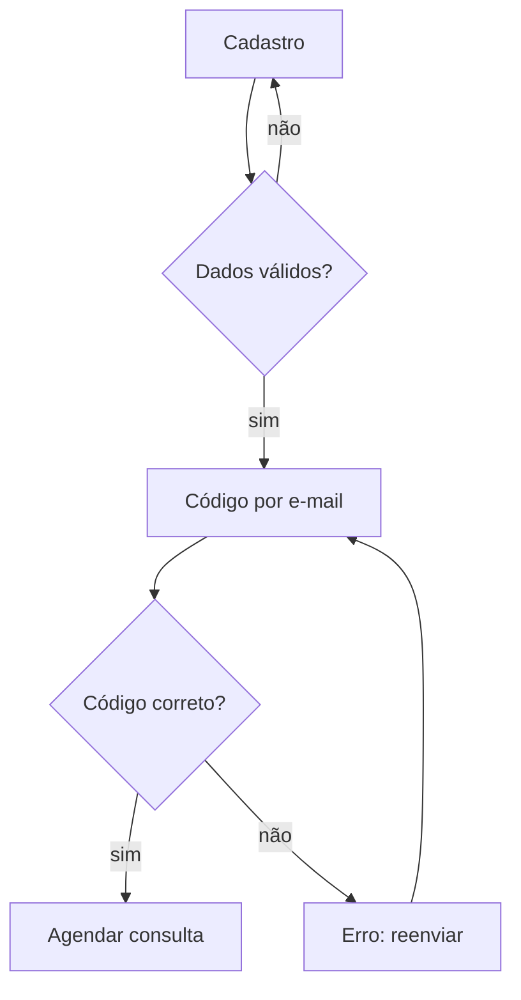

# Fluxo de tela

Template T-12. Uso: `design-brief` (modo `fluxo`) e `ui-designer`. **Rótulo: Inferido.** O método vem de conhecimento estável do domínio; a validação do segmento não encontrou fonte A ou B lida sobre user flows (lacuna). Pontos de abandono prováveis são hipóteses "a validar", nunca resultados.

## 1. Objetivo e ponto de entrada

- **Objetivo do usuário:** [ex.: concluir o cadastro e agendar a primeira consulta]
- **Ponto de entrada:** [link, tela, notificação]
- **Sucesso observável:** [o que o sistema registra quando termina]

## 2. Passos

| # | Tela | Decisão do usuário | Ação | Resposta do sistema | Estado resultante |
| --- | --- | --- | --- | --- | --- |
| 1 | [Cadastro] | [criar com e-mail ou com conta social?] | [preenche e envia] | [valida; envia código] | [aguardando código] |

## 3. Ramos

| Ramo | Gatilho | O que o usuário vê | Como volta ou conclui |
| --- | --- | --- | --- |
| Erro | [código expirado] | [mensagem em três partes, mantém o e-mail digitado] | [reenviar código] |
| Vazio | [sem horários] | [explica por quê + ação] | [escolher outra data] |
| Cancelamento | [fecha o modal] | [confirma o que será perdido] | [volta à etapa anterior] |
| Voltar | [botão do sistema] | [estado preservado] | [continua de onde parou] |

## 4. Wireframe de baixa fidelidade (por tela-chave)

Texto ou ASCII: blocos de conteúdo e ação primária, sem estética.

```text
+------------------------------+
| [Logo]              [Ajuda]  |
| Passo 2 de 4                 |
| Título: o que fazer aqui     |
| [ Campo: e-mail            ] |
| [ Campo: senha             ] |
| ( Criar conta )  <- primária |
| Já tenho conta (link)        |
+------------------------------+
```

Ou diagrama Mermaid:



## 5. Pontos a validar

| Ponto | Hipótese | Como validar |
| --- | --- | --- |
| [passo 2] | [pessoas podem travar ao criar a senha] | [`heuristic-eval` do passo; teste de usabilidade com 5 participantes do perfil (`user-research-plan`)] |

## 6. Estados e acessibilidade por tela

[Estados obrigatórios (vazio, carregando, erro, texto longo, 320 px); foco inicial após cada transição; título anunciado em troca de rota; critérios 3.3.7 (entrada redundante) e 3.3.8 (autenticação) quando houver.]
